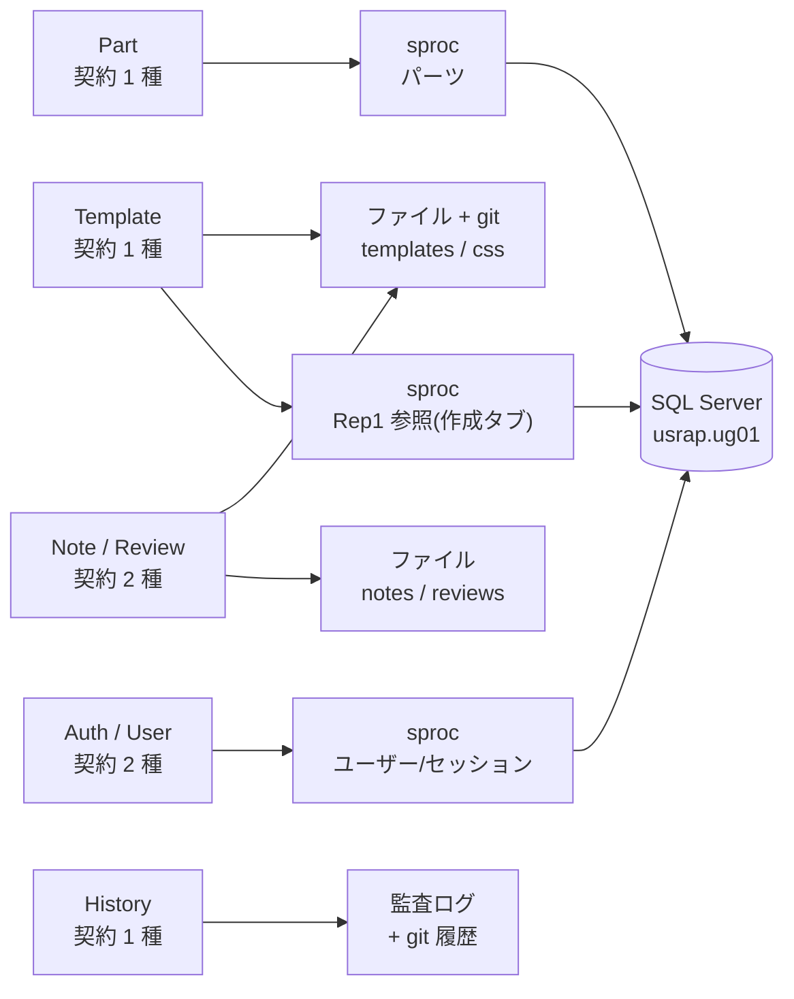
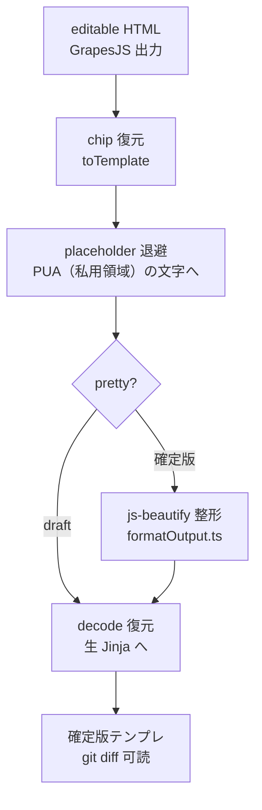
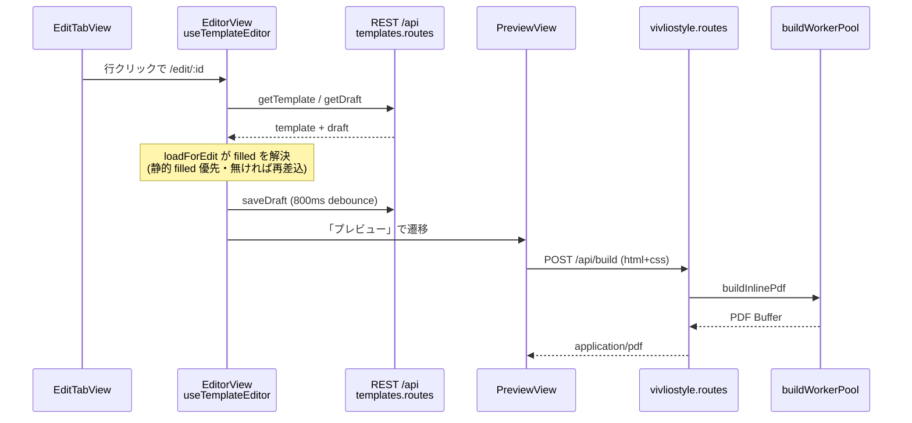
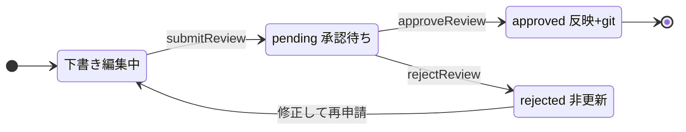

本書は Editor（運報自動化テンプレート編集 Web アプリ）の構造・データ抽象化・編集エンジン・承認ワークフロー・`rest`（REST + SQL Server）を、TypeScript / Vue にまだ慣れていない読者でも実装を追えるところまで掘り下げて記述する。一次資料は `editor/README.md`・`editor/CONTRIBUTING.md`・`shared/src/` の型と Repository 契約・`server/` 各層。本文中のコード抜粋はすべて実ソースからの引用で、引用元をパスで示す。

# 1. 用語解説

| 用語 | 意味 |
|---|---|
| Jinja2 | Python 系のテンプレート言語。`{{ 変数 }}`・``・`{# コメント #}` を HTML に埋め込む。本ツールの編集対象。 |
| Nunjucks | Jinja2 とほぼ同じ文法の JavaScript 実装。ブラウザ内プレビューの描画に使う（近似であり完全互換ではない）。描画は隔離 iframe の中だけで行う（7.1 節）。 |
| 私用領域（PUA） | Unicode の私用領域（Private Use Area）。通常の文字と衝突しない予約コードで、Jinja トークンの一時退避先に使う（6.2 節）。 |
| GrapesJS | ブラウザで動く WYSIWYG エディタ部品。HTML を DOM として編集するため、素の Jinja タグは壊れる。これを守るのが mask/restore（6 章）。 |
| Repository パターン | 「データの取得・保存」をインターフェースとして切り出す設計。画面はインターフェースだけに依存し、実装（REST 実装やテスト用の偽物）を差し替えられる。 |
| DTO | Data Transfer Object。層をまたいで受け渡す入れ物の型（例: `DropdownQuery`）。 |
| Result 型 | 失敗を例外でなく戻り値で表す型。`{ok:true, value}` か `{ok:false, error}` のどちらか（3 章）。 |
| Zod | TypeScript のスキーマ検証ライブラリ。型定義と実行時検証を一体化でき、本ツールでは**型の正典**（3 章）。 |
| pnpm workspace | 1 リポジトリに複数パッケージ（shared/web/server）を置いて依存を共有する仕組み。 |
| Pinia store | Vue の状態管理。画面をまたいで持ちたい状態（ログインユーザー等）の置き場。 |
| composable | Vue の再利用ロジック関数（`useXxx`）。状態とふるまいをコンポーネントの外に切り出す。 |
| Fastify | Node.js の Web サーバフレームワーク。server パッケージの土台（9 章）。 |
| sproc ゲートウェイ | DB アクセスを対象ごとに 1 本のストアドプロシージャへ集約し、処理内容は第 1 引数 `@操作` で分岐させる方式（10 章）。 |
| vivliostyle | HTML+CSS を印刷用のページ（A4 等）に組版するライブラリ。ブラウザ内組版（`@vivliostyle/core`）と PDF 生成 CLI（`@vivliostyle/cli`）の両方を使う。 |
| 2 系統の原則 | 「編集タブ = 実値埋め込み済み HTML をハイライト無しで編集」「作成タブ = 共通サンプルで値入りに見せてハイライト有り」という本ツールの根幹規約（6.1 節）。 |

# 2. 全体アーキテクチャ

pnpm workspaces で 3 パッケージに分離し、テンプレート実体はリポジトリ**外**の data リポジトリ（`dataRoot`）に置く。パッケージマネージャは `pnpm@11.18.0+`、Node `>=24`。ポートは **server = 24680 / Vite dev = 24681** の対で固定する（`server/src/config.ts` の `port` 既定値と `editor/start.bat`。3001 等の Node 系定番を避けた固有帯）。


| ワークスペース | 責務 |
|---|---|
| `shared/`（`@editor/shared`） | 共有 TS 型/DTO + `Result`/`AppError` + ドメイン + Repository 契約（**型の真実源**） |
| `web/` | Vue3 + Vite + Vue Router + Pinia + Tailwind v4 + shadcn-vue + GrapesJS + Nunjucks + vivliostyle |
| `server/` | Fastify + TS（PDF 生成 / ファイル索引 / Python 生成器アダプタ / `rest` 向け REST・SQL） |
| `../../editor-data/`（リポジトリ外） | テンプレート実体の data リポジトリ（既定 `dataRoot`）。`templates/`（.html）・`css/`（テンプレ毎。`<会社>_<ファンド>_<版種>.css`）・`drafts/`（自動保存。git 管理外）・`reviews/`（承認申請。git 管理外）を持ち、確定保存ごとに 1 コミットで版管理する |

> [!INFO] **data ルートはリポジトリ外**: 既定は `dataRoot = ../../editor-data`（repoRoot 相対。`server/src/config.ts` の `dataRoot`）。ワークスペースリポジトリの外に置くのは**ネスト git を避ける**ためで、初期化（git init + .gitignore/.gitattributes）は `editor/scripts/init-data-repo.bat` が行う。上書きは env `DATA_ROOT` または `appconfig.json` の `paths.dataRoot`。本文で `dataRoot/templates` 等と書くときはこの editor-data 配下を指す。

> [!INFO] `allowBuilds`（pnpm 11 ルール）で esbuild / vue-demi / @vivliostyle/cli / @biomejs/biome のビルドスクリプトを明示許可する。承認は `pnpm-workspace.yaml` 側で行う（`package.json` 側は無効）。

## 2.1 「1 リクエストの旅」（属性ドロップダウン取得の縦貫例）

画面の 1 操作がどの層をどう通るかを、代表例（編集タブの属性ドロップダウン）で追う。

| 段 | ファイル・関数 |
|---|---|
| 1. 画面 | `web/src/features/templates/components/SearchFilters.vue`（`useCascadingSelect` で 4 段カスケード。編集タブは `dropdown-scope="edit"` を渡す） |
| 2. Repository | `web/src/api/rest/templateRepo.ts` の `getDropdownOptions` |
| 3. REST クライアント | `apiFetch(apiPaths.templatesOptions)` = `GET /api/templates/options?scope=edit` |
| 4. server route | `server/src/routes/templates.routes.ts`（`preHandler: requireAuth`） |
| 5. server repository | `server/src/repositories/templateRepo.ts` の `getDropdownOptions` |
| 6. ファイル | `scope` が `edit` なら `filled/` + `pending/`（基準日を持つものだけ）、`published` なら `filled/` だけのファイル走査（DB は通らない） |

server 側 5〜6 段の実装。候補の出所は画面ごとに違う。編集タブ（`edit`）は一覧と同じ `filled/` + `pending/`（基準日を持つ値入り HTML だけ。作成タブの生成物 `会社_ファンド_版種` は作成タブの「作成中のテンプレートを開く」から開く）、比較・結合（`published`）は承認済みの `filled/` だけを走査する:

```ts
async getDropdownOptions(q, scope) {
  return optionsFromMetas(await scanEditableMetas(scope === 'edit'), q);
},
```

候補（`optionsFromMetas`）は「自分より上位の選択だけで絞る」規則で作る。照合は大文字小文字を区別せず、大文字小文字だけが違う値は 1 つにまとめる。

作成タブの連動プルダウン（`CreateFundSelect.vue`）だけは出所が違い、まだテンプレートの無いファンドも選べるよう、同じサーバの `Rep1` にあるファンド属性を usrap の sproc から読む。委託会社は `GET /api/templates/companies`（sproc `テンプレート` の `委託会社一覧`）、ファンドは会社を選んだときに `GET /api/templates/funds`（`ファンド一覧`。Rep1 の委託会社コードで一括取得）で取る。ファイル名の会社コードは Rep1 の委託会社略称で、Rep1 の委託会社コード（`rep1CompanyCode`）とは書式が違う。会社とファンドがそろうと（版種は任意）`GET /api/templates/creatable` が版ごとの状態 `editions`（版種を指定すればその版の 1 件、無ければ交付版・全体版の 2 件。`state` は、テンプレートフォルダ `templates/` に `会社_ファンド_版種.html` があれば `created`（大文字小文字は区別しない）、承認待ちの作成申請があれば `pendingReview`、同じ id の下書きか `pending/` があれば `inProgress`、どれも無ければ `none`。`created` と `inProgress` では `templateId` も返す）と、シリーズのコピー元候補（sproc `シリーズ` の `一覧` + `templates/` に両版のテンプレートがあるか）を返す。

委託会社とファンド名の表示は、作成タブ以外の画面（編集・比較・結合・承認・編集画面の上部バー）でも同じ 2 操作から引く（`web/src/lib/useRep1Names.ts`）。ファイル名の会社コード（略称）で `委託会社一覧` を引いて「略称（Rep1 の委託会社コード）」と表示し、その Rep1 の委託会社コードで `ファンド一覧` を引いてファンド名を出す。Rep1 のファンド一覧は会社単位でしか引けないので、ファンド名の解決には会社の略称が要る。取得結果はページを再読み込みするまで保持し、失敗は保持せず次の表示で取り直す。Rep1 に無い委託会社・ファンドは「（未登録）」と出し、取得前・取得中・失敗の間は略称・コードだけを出す。差し込み用のサンプルデータ（`usp_サンプルデータ`）はファンド名の表示には使わない。

> [!INFO] **DB の守備範囲**: DB はパーツ・認証・監査・注記マスタと、作成タブが読むファンド属性（`Rep1`。sproc 経由）のみで、**テンプレート本体はファイル + git が正**。テンプレートの台帳は持たない。`listTemplates` と編集タブの候補は `filled/`（値入り HTML）+ `pending/`（生成直後の未確定）のうち、名前が基準日を持つ 4 つ区切り（`会社_ファンド_基準日_版種.html`）のものだけ、比較・結合の候補は `filled/` だけのファイル走査、作成済みの判定とシリーズのコピー元の有無もファイル名で行い、`getTemplate` は id の形で探し先を分け、値入り HTML（4 つ区切り）は `filled/` → `pending/`、テンプレート（3 つ区切り）は `templates/` → `pending/` の順に読む。いずれも sproc を通らない。「本体=ファイル/git、DB は参照とメタだけ」が `rest` の基本方針。

もう 1 本の代表例「確定保存」は承認ゲートを通る: プレビュー画面の申請 → `POST /api/review-requests`（`dataRoot/reviews/` に保存、実ファイル非更新）→ 承認時に `applyConfirmedWrite`（実ファイル書込 + git コミットの**唯一の関所**）。詳細は 8 章。

# 3. shared: 型の真実源

## 3.1 Result 型（`shared/src/result.ts`）

失敗を例外でなく値で運ぶ。全 Repository メソッドが `Promise<Result<T>>` を返すため、呼び出し側は `if (!res.ok)` の分岐だけでエラー処理が書ける:

```ts
export type Ok<T> = { ok: true; value: T };
export type Err<E> = { ok: false; error: E };
export type Result<T, E = AppError> = Ok<T> | Err<E>;

export const ok = <T>(value: T): Ok<T> => ({ ok: true, value });
export const err = <E>(error: E): Err<E> => ({ ok: false, error });

/** 成功値を変換する。エラーはそのまま素通しする。 */
export const map = <T, U, E>(r: Result<T, E>, f: (value: T) => U): Result<U, E> =>
  r.ok ? ok(f(r.value)) : r;
/** Result を返すステップを連結する。最初のエラーで短絡する。 */
export const andThen = <T, U, E>(r: Result<T, E>, f: (value: T) => Result<U, E>): Result<U, E> =>
  r.ok ? f(r.value) : r;
```

## 3.2 AppError（`shared/src/errors.ts`）

エラーは 7 種の `kind` に正規化する。`message` は常にユーザー表示可能な日本語、技術詳細は `cause`（ログ専用）に隔離する:

```ts
export type AppErrorKind =
  | 'not_found' | 'validation' | 'unauthorized'
  | 'forbidden' | 'conflict' | 'network' | 'unexpected';

export interface AppError {
  kind: AppErrorKind;
  message: string;      // ユーザー向け・日本語。常に表示して安全
  cause?: unknown;      // ログ専用 — ユーザーには出さない
  code?: string;        // 機械可読の任意コード 例 'USER_DISABLED'
}
```

`toAppError(cause)` が「throw されたもの → AppError」の継ぎ目で、既に AppError ならそのまま返す。

## 3.3 ドメイン型は Zod スキーマが正典

主要なドメイン型は `shared/src/schemas.ts` の **Zod スキーマが正典**で、`shared/src/index.ts` は `z.infer` で TS 型を導出する。手書き interface での二重定義はしない（手書きの例外は `ConfirmSaveRequest` / `TemplateInstance` のみ）。スキーマは実行時検証（server の `validate.ts`）と OpenAPI 生成（zod-openapi）にも共用される:

```ts
export const Template = z.object({
  meta: TemplateMeta,
  html: z.string().meta({ description: 'Jinja2 生 HTML(タグ保持)' }),
  css: z.string().meta({
    description: 'テンプレ単位の CSS(css/<会社>_<ファンド>_<版種>.css。基準日違いの文書で共有)',
  }),
  filled: z.string().meta({ description:
    'エディタキャンバス用に事前描画した filled HTML(Jinja 値を差し込みつつ元ソースを保持)。' +
    '静的な fill が無ければ空で、エディタは都度描画にフォールバックする' }),
  cssMissing: z.boolean().optional().meta({ description:
    '確定版の CSS ファイル(css/<会社>_<ファンド>_<版種>.css)が見つからないとき true。' +
    'あれば付けない。生成直後(pending)は対象外' }),
}).meta({ id: 'Template' });

export const UserRole = z.enum(['admin', 'approver', 'editor', 'viewer']);
```

- **テンプレート同一性**: `TemplateAttributes`（`companyCode` 委託会社 / `fundCode` ファンド / `baseDate` 基準日 yyyymmdd。値入り HTML だけが持つ / `editionType` 版種）。ファイル名規約は値入り HTML が `company_fund_date_edition.html`、テンプレートが `company_fund_edition.html` で、区切りの数で見分ける。変換は `shared/src/domain/template.ts`（`templateFileName` / `parseTemplateFileName` / `skeletonFileName` / `parseSkeletonFileName` / `parseAnyTemplateFileName`）の純関数。
- **履歴 3 種**（編集 / PDF 出力 / 作成）+ パーツ単位 `PartHistoryEntry`、**版スナップショット**（`TemplateSnapshot` / `TemplateVersionMeta`）、**パーツカタログ**（`PartClassification` 4 段 / `PartCatalogItem`）、**承認系**（`ReviewRequestMeta` / `ReviewRequest` 等。8 章）。
- **パーツ一覧の版種による絞り込み**: パーツカタログは `対象版種`（NULL と空文字列は両版共通、値はテンプレートの版種と同じ文字列で固定しない）を持つ。編集画面の `PartCatalog` は開いているテンプレートの `meta.attributes.editionType` を `GET /parts` と `GET /parts/classification-options` の `editionType` に載せ、sproc `part` の `@版種` が、`対象版種` が NULL か空文字列か `@版種` と一致する行に一覧と 4 区分の分類候補を絞る。版種が空のテンプレートと、版種を渡さない呼び出し（Inspector の参照用に全件を引く `loadForEdit`、ペア同期の `pairSyncService`、注記マスタの `noteMasterService`、承認画面でパーツ名を引く `reviews/services/partNames.ts`）は全件を受け取る。版種は URL クエリ（`pc` 接頭辞の同期）に載せない。`対象版種` は一覧の表示だけに使い、ペア同期のポリシーは `同期既定` だけで決める。カタログには別ツール用に `カテゴリ英名`・`大分類英名`・`中分類英名`・`小分類英名` の 4 列もあるが、sproc は返さず、API・shared の型にも載せない（editor は読まない）。

## 3.4 Repository 契約（全 7 種）

画面/サービス/ストアは**集約ごとの Repository インターフェース**（`shared/src/repositories/*`）にのみ依存する。全メソッドは `Result<T>` を返す。

| Repository | メソッド |
|---|---|
| `AuthRepository` | `login` / `logout` / `me` / `initPassword` |
| `TemplateRepository` | `getDropdownOptions` / `listTemplates` / `getTemplate` / `generate` / `listCompanies` / `listFunds` / `getCreatableInfo` / `saveDraft` / `getDraft` / `discardDraft` / `confirmSave` / `getSampleData` |
| `HistoryRepository` | `getEditHistory` / `getPdfHistory` / `getCreateHistory` / `recordPdfExport` / `listVersions` / `getSnapshot` |
| `PartRepository` | `getPartClassificationOptions` / `listParts` / `listPartHistory` / `recordPartChange` |
| `UserRepository` | `listUsers` / `createUser` / `updateUser` / `resetUserPassword` |
| `NoteRepository` | `listNotes` / `addNote` / `updateNote` / `deleteNote`（追記型スレッド、`content` 空文字は拒否・削除は明示） |
| `ReviewRepository` | `submitReview` / `listReviews` / `getReview` / `approveReview` / `rejectReview` |

承認ゲートの核となる `ReviewRepository` の契約（`shared/src/repositories/ReviewRepository.ts`）:

```ts
export interface ReviewRepository {
  /** 確定保存を申請する(pending 作成・実ファイル非更新)。 */
  submitReview(req: SubmitReviewRequest): Promise<Result<ReviewRequestMeta>>;
  /** 申請一覧。状態で絞り込める。 */
  listReviews(filter?: ReviewListFilter): Promise<Result<ReviewRequestMeta[]>>;
  /** 申請 1 件を本体込みで取得する(承認画面のプレビュー用)。 */
  getReview(reqId: string): Promise<Result<ReviewRequest>>;
  /** パーツ判定をまとめて変更する(承認・却下・取り消し。最終確定前・pending の申請だけ。許されない遷移が 1 件でもあれば conflict で全部戻す)。 */
  updatePartDecisions(reqId: string, input: UpdateReviewPartDecisionsRequest): Promise<Result<ReviewPartDecision[]>>;
  /** 承認して実ファイルへ反映する(approver|admin のみ)。反映後メタ + 並行性警告を返す。 */
  approveReview(reqId: string, decision: ReviewDecisionRequest): Promise<Result<ApproveReviewResult>>;
  /** 却下する(approver|admin のみ)。理由は decision.comment。 */
  rejectReview(reqId: string, decision: ReviewDecisionRequest): Promise<Result<ReviewRequestMeta>>;
}
```

7 契約と永続先の対応（`rest`。route 対応の一覧表は 9.2 節）。「本体=ファイル/git、DB は参照とメタだけ」（2.1 節）が形になっている:

<!-- ノードラベルは短い 2 行構成に保つ。長い行は Mermaid が CJK 幅を過小計算し枠外へ見切れる。 -->



（Review の `F1` への線は承認時の `applyConfirmedWrite` = 実ファイル反映 + git コミット。8 章。）

# 4. データアクセス層の構成

## 4.1 合成ルート（`web/src/api/repositories.ts`）

web のデータの取り出し口は `rest`（REST + SQL Server）の 1 系統だけである。かつてあった開発用の `local`（fixtures + localStorage）は撤去した。`repositories.ts` は REST リポジトリを 1 つの束ねオブジェクトに合成する DI の合成ルートで、画面は Repository **契約**にだけ依存する:

```ts
export const restRepositories: Repositories = {
  auth: restAuthRepo,
  templates: restTemplateRepo,
  parts: restPartRepo,
  history: restHistoryRepo,
  notes: restNoteRepo,
  reviews: restReviewRepo,
  users: restUserRepo,
  fundAssets: restFundAssetRepo,
};
```

`web/src/main.ts` が `app.provide(REPOS_KEY, restRepositories)` で配り、画面へは Vue の provide/inject（`useRepos()`）で届く。テストは同じ形の偽物を provide して差し替える。

## 4.2 リポジトリの実装例（`getTemplate`）

REST 実装は REST への委譲のみ（`web/src/api/rest/templateRepo.ts`）:

```ts
getTemplate: (id: string) =>
  attemptRest(() => apiFetch<Template>(buildPath(apiPaths.templateById, { id }))),
```

`getTemplate` は id の形で探し先を分ける。値入り HTML（4 つ区切り）は `filled/` → `pending/`、
テンプレート（3 つ区切り）は `templates/` → `pending/`。`filled/` で見つかれば `html` と `filled` の両方に
本文を返す。一覧は `filled/` と `pending/` だけから作る。

「throw → Result」の継ぎ目は共通ヘルパー `attemptRest`（`web/src/api/rest/attempt.ts`）に集約。REST トランスポート `apiFetch`（`web/src/api/rest/http.ts`）は `credentials: 'include'`・`/api` プレフィックス付与・HTTP エラー→AppError 変換（サーバの `{kind, message, code}` を優先、無ければ status→kind 表）を一手に担う。

## 4.3 値入り HTML の出どころ（2 系統の原則のデータ源）

編集タブが読む「値埋め込み済み HTML」は、本番では dataRoot の `filled/` にある（後述）。テスト用の
fixture（`editor/fixtures/`）では、`genFilled.ts`（`pnpm --filter web run gen:filled`）が
`fixtures/templates/*.html`（生 Jinja）+ `fixtures/sample/<fund>.json`（**per-fund 実値**）から
`fixtures/filled/*.html`（= `Template.filled`）を事前生成する:

```ts
function resolveSample(fundCode, editionType): SampleData {
  const file = resolve(sampleDir, `${fundCode}.json`);
  if (existsSync(file)) {                       // ファンド別実値を正典に
    const real = JSON.parse(readFileSync(file, 'utf8')) as SampleData;
    return applyEdition(real, editionType);     // 版種だけファイル名由来で上書き
  }
  return buildSampleData(funds[fundCode], fundCode, editionType); // 無ければ共通ダミー
}
```

**filled を全ファンド共通ダミーに潰してはならない**（編集タブが実値を失う退行。6.1 節のガードテストが機械検証する）。

server は dataRoot の `filled/<テンプレID>.html` を返す。別ツールが置き、承認（`origin='edit'`）が
上書きする。値入り HTML は値がすでに差し込み済みで、作成タブの往復用の印（6.2 節）を持たない。
テスト用の fixture（`fixtures/filled/*.html`）も同じ形で、`genFilled.ts` が `renderPlainFilled` で
属性値の中の Jinja まで値にして作る。印が残った本文は申請・承認で 400 になる（6.2 節）。プレビュー・比較・
結合 PDF はこの値入り HTML を nunjucks（`toTemplate`/`renderJinjaIsolated`）へ通さずそのまま
組版する（`Boolean(tpl.filled)` で判定。空文字と未定義をまとめて「無し」とする）。

作成タブ（`origin='create'`）の承認は従来どおり `templates/` に Jinja を書く。

# 5. フロントエンド構成

## 5.1 ルーティングと authGuard（`web/src/router/index.ts`）

- public: `/login`, `/password-init`（`meta.public`）。
- `MainLayout` の子: `edit`（`/` 既定）/ `create` / `compare` / `reviews` / `history` / `merge` / `admin`（`meta.admin`）/ `edit/:id`（エディタ）/ `preview/:id`（プレビュー）。
- エディタとプレビューは `meta.flush` を持ち、`MainLayout` が本文の余白を落として残りの高さを全部使わせる（全画面ルートは持たない。アプリヘッダとタブは常に見える）。

ガードは `beforeEach` 本体を関数として切り出し、auth ストアを引数注入してテスト容易にしている:

```ts
export async function authGuard(to, auth: AuthGuardState = useAuthStore()) {
  if (!auth.ready) await auth.bootstrap();
  if (to.meta.public) return true;
  if (!auth.isAuthenticated) return { name: 'login', query: { redirect: to.fullPath } };
  if (auth.mustChangePassword && to.name !== 'password-init')     // 初回PW変更を強制
    return { name: 'password-init', query: { username: auth.user?.username ?? '', redirect: to.fullPath } };
  if (to.meta.admin && !auth.isAdmin) return { name: 'edit' };
  return true;
}
```

## 5.2 Pinia stores（2 本）

- `auth.ts`: ログインユーザー・`bootstrap`/`login`/`logout`・`isAdmin`/`isApprover`/`mustChangePassword`。再起動失効の検知（11 章の `appEpoch`）とも連携。
- `editorSession.ts`: `templateId` キーで編集セッション（パーツ履歴・Undo past/future）を保持。`/edit ⇄ /preview` の往復で `EditorView` が再マウントされても Undo 履歴が生存する。localStorage へ debounce 永続化（深さ上限 20）。

## 5.3 features/（9 領域）と lib/

| 領域 | 画面 |
|---|---|
| `auth` | ログイン / パスワード初期設定 |
| `layout` | `MainLayout`（タブシェル） |
| `templates` | 編集タブ / テンプレート作成タブ / 履歴タブ |
| `editor` | GrapesJS 3 ペインの編集画面 |
| `preview` | vivliostyle プレビュー・PDF 出力・確定保存申請 |
| `reviews` | 承認タブ（全申請の一覧と、対象テンプレートの申請をパーツごとに判定して最終確定する詳細） |
| `compare` | 版比較（block diff） |
| `merge` | 結合PDF タブ（複数テンプレート → 通しページ番号付き 1 PDF。7.2 節） |
| `admin` | ユーザー管理 |

`lib/` の主要ユーティリティ: `jinjaMask.ts`（`toTemplate`。6.2 節）/ `fillJinja.ts`（`toFilled`。`shared` の `jinjaExpr.ts` の許可リスト式評価器で値を差し込む）/ `htmlScan.ts`・`fillAnalysis.ts`（往復の判断の土台。6.2 節。ブロック木と印なし描画は shared の `jinjaTree.ts`・`fillRender.ts`）/ `renderHostClient.ts`（隔離 iframe への Jinja 描画依頼）/ `nunjucksRender.ts`（描画済み HTML のプレビュー文書組み立て）/ `sanitizeHtml.ts`（DOMPurify）/ `formatOutput.ts`（js-beautify 整形）/ `cropMarks.ts`（トンボ）/ `appEpoch.ts`（11 章）/ `useAsyncResult.ts`（loading + toast）/ `useCascadingSelect.ts` / `usePagedList.ts` 等。

# 6. 編集エンジン詳解

## 6.1 編集 2 系統の原則（根幹）

編集体験は 2 系統あり、これはツールの根幹規約である。

| | 編集タブ（既存編集） | テンプレート作成タブ（新規作成） |
|---|---|---|
| 経路 | `EditTabView` → `/edit/:id`（query なし） | `CreateTabView` → `/edit/:id?created=1` |
| キャンバスに載る HTML | `tpl.filled`（**per-fund 実値**の値埋め込み済み HTML） | `toFilled(tpl.html, 共通sample)`（表示のみ値入りに見せる） |
| 差し込み値ハイライト | **出さない**（値は実値であり地の本文） | **出す**（placeholder の可視化） |

作成済み・作成中のテンプレートは、作成タブの「既存のテンプレートを開く」「作成中のテンプレートを開く」（版種を選ばないときは「既存の交付版を開く」「作成中の全体版を開く」のように版ごと）から作成経路で開く。版種を選ばずに両版を作った直後は、成功の帯の「交付版を開く」「全体版を開く」のカードから作成経路で開く。作業中の置き換えは確認ダイアログで同意を得てから行い、同じタブの編集状態（Undo と下書きの持ち主）も捨てる。基準日を持たないテンプレートでは上部バーと属性欄に基準日を出さない。

経路の見分けは一貫して `route.query.created === '1'`。実装上の出し分けは `useTemplateEditor.ts` の 1 行と、`useGrapes.ts` の `setVarsHighlight` に集約される:

```ts
g.init({ canvas, layers });
g.load(res.value.editableBody, res.value.css);
// 差し込み値ハイライトは作成経路(?created=1)でのみ。編集経路は実値編集なので出さない。
g.setVarsHighlight(route.query.created === '1');
```

```ts
function setVarsHighlight(on: boolean): void {
  varsHighlight = on;
  editor.value?.Canvas.getBody()?.classList.toggle('jinja-vars-highlight', on);
}
```

ハイライト CSS は `jinjaComponents.ts`。**素の `.jinja-chip.jinja-var` に背景を直書きせず**、body に `jinja-vars-highlight` クラスが付いたときだけ効かせる（直書きすると編集タブへハイライトが漏れる）:

```css
/* 素の値チップは本文と同化（両系統で常時）。背景は直書きしない */
.jinja-chip.jinja-var { display: inline; padding: 0; border: 0; color: inherit;
  font-family: inherit; font-size: inherit; white-space: normal; }
/* 差し込み値ハイライト（薄い琥珀）は作成経路だけ */
.jinja-vars-highlight .jinja-chip.jinja-var {
  padding: 0 1px; border-radius: 3px; background: rgba(245, 158, 11, 0.16);
  box-decoration-break: clone; }
```

> [!WARN] 退行ガードテスト `web/test/twoSystems.guard.test.ts` が「①素のチップに background 直書きが無い ②`.jinja-vars-highlight` 配下のみ背景定義 ③異なるファンドの filled で値が異なる（共通ダミー化していない）」を機械検証する。この 3 条件を壊す変更は禁止。

## 6.2 作成タブの往復（`toFilled` ⇄ `toTemplate`）

GrapesJS は HTML を DOM として扱うため、Jinja の原文をそのまま読み込むと Jinja タグが壊れる。作成タブは
`toFilled`（`web/src/lib/fillJinja.ts`）で原文を「値入りに見える、Jinja へ戻せる HTML」へ変換してから
キャンバスへ載せ、保存時に `toTemplate`（`web/src/lib/jinjaMask.ts`）で Jinja の原文へ戻す。編集タブの
値入り HTML（6.1 節）はこの往復を通らない。

**判断は原文の位置で 1 回だけ行う。** `toFilled` は次の 3 段で、どこに何を置くかを先に決めてから書く。

| 段 | ファイル | 役割 |
|---|---|---|
| 字句解析 | `shared/src/jinja/jinjaLex.ts`（`lexJinja`）と `shared/src/jinja/jinjaTree.ts`（`parseJinja`） | 原文を位置つきのトークンに切り、if / for の開閉と枝を木にする。字句解析は申請の関所（後述）と同じ 1 つの関数を使う |
| 構造の走査 | `web/src/lib/htmlScan.ts`（`scanHtml`） | Jinja を伏せた原文を、ブラウザの構文規則に沿って読み、要素の範囲と各位置の文脈（表の中・SVG の中・属性値の中など）を出す |
| 位置の判定 | `web/src/lib/fillAnalysis.ts`（`analyzeFill`） | 印を置ける位置と、固める要素を決める |

出力の形は次のとおり。

- **差し込み値・文・コメントのトークン**は、テキストの位置ならチップ（`<span data-jinja="(base64)">`）にする。
  出力は評価した値を表示し、文とコメントは原文を表示する。固めていない要素の属性値の中の Jinja は原文の
  まま残し、チップにも値にもしない（固めた要素は、表示用に属性値の中まで値を入れて描く）。
- **if / for のブロック**は、HTML コメントの印で範囲を表す。
  `&lt;!--jinja-rt:o:<id>:<前半>-->` と `&lt;!--jinja-rt:c:<id>:<後半>-->` で採用した枝の本文を挟み、前半・後半に
  採用しなかった枝を含む原文（base64）を持たせる。保存時は「前半 + 採用した枝の編集後の内容 + 後半」を
  出すので、採用した枝への編集はその枝へ書き戻され、他の枝は 1 バイトも変わらない。for の 2 回目以降の
  繰り返しは `&lt;!--jinja-rt:x:<id>-->` の後ろに並ぶ表示専用の写しで、保存時に捨てる。
  表・`select` の文脈に置かれた範囲を持たない文と Jinja コメント（``・`{# … #}`）は、チップを
  置けないので `&lt;!--jinja-rt:t:<base64>-->` の印で表す。
  コメントを使うのは、HTML パーサが表（`table` / `tr`）や SVG の中でもコメントを動かさず、GrapesJS も
  コメントをそのまま書き出すからである。
- **印を置けない位置**（表の行の間の値・SVG の中・本文中の `<style>` など）は、それを含む最小の安全な要素を
  **固める**。固めた要素は値入りの見た目で表示し、保存時は原文に戻す（`data-gjs-type="jinja-frozen"`。
  レイヤー名は「編集不可（Jinja）」）。表の中で固めた範囲は `div.jinja-frozen-body`（`display: contents`）で
  包み、表の外へ追い出されたテキストもその中に留める。固めた SVG の子孫は SVG の名前空間で描く部品型
  （`jinja-frozen-svg-in`）にする。`<style>` / `<textarea>` / `<title>` はチップ（`jinja-rawtext`）にする。
- **自己検査**: `toFilled` は自分の出力を `toTemplate` で戻し、原文と比べる。比べる前に
  `normalizeForRoundTrip` で、GrapesJS が読み込みで捨てる空白を同じ規則で捨て、テキスト位置の Jinja を
  コメントに置き換えて位置を固定し、属性の順序を揃える。食い違えば本文全体を固める（安全側に倒す）。

キャンバスの読み込み（`useGrapes.ts`）は、本文の断片を `parse:html:before` で `<body>` に包んでから解析
させる。包まないと、先頭の要素より前のコメント（ブロックの開きの印）が HTML の構文規則で body の外へ出て
消える。

`toTemplate(editable)` は逆変換である。断片を文書（`asDocument`）に包んでから解析し、印の書式と開閉の対応、
印の中身の形を検査してから、Jinja トークンを一旦 Unicode 私用領域（PUA。通常の文字と衝突しない予約コード）の
placeholder に退避し、（必要なら js-beautify で整形し）最後に文字列置換で復元する。HTML シリアライザが
`<` `>` `&` をエスケープして Jinja を壊す事故はこれで防ぐ。対応が崩れている・編集用の印が残る・結果を
`parseJinja` で読めない、のどれかなら例外にする（プレビュー画面では検証エラーとして出る）。黙って壊れた
テンプレートを作ることはない。

**編集用の印の関所**: 印の定義は `shared/src/security/editingMarkers.ts` の `findEditingMarkers` 1 つで、
`toTemplate` の事後検査、server の申請（`reviewRepo.submitReview`）と確定書込（`confirmedWrite`。
`editingMarkerGate.ts` 経由）が共用する。作成・編集の両経路で、印の残った本文を 400 で拒否する。検出は、原文をブラウザと同じ規則で読む走査に、Jinja を伏せた
写しの走査を足したものである（伏せ方は `lexJinja` と最短一致の 2 通りの区切り × 空白と `J` の 2 通りの
伏せ字。伏せた写しは、偽の枝の中の `&lt;!--` のような見かけのコメントに隠れないよう、コメントの中まで読む
走査も掛ける。どれかで見つかれば印とし、同じ位置の同じ印は 1 件にまとめる）。Jinja の中の `<` や引用符が
見かけのタグ・コメントを作っても、本物のタグを見落とさないためである。ただし調べるのは原文で、描画結果では
ない。印をまるごと Jinja の式で組み立てた形（`{{ "<span data-jinja>" }}`）は見つからない。dataRoot に印の焼き付いたファイルが無いかは
`editor/server/scripts/find-baked-markers.ts`（読み取りだけ）で確かめる。

**旧形式の下書き**（要素の属性 `data-jinja-open` などで印を持つ形）は読まない。編集画面を開いたときに
`legacyDraft.ts` の `isLegacyDraft` で見分けて破棄し（作成経路の下書きは旧形式の属性が 1 個でもあれば、
編集タブの下書きは編集用の印が 1 個でもあれば旧形式とみなす。編集タブの本文はもともと印を持たない）、トーストで知らせて確定版から開き直す。旧形式の if は
採用した枝しか持たないので、新形式へ変換しても結果を信用できない。

保存・確定時の出力整形（`toTemplate` の `pretty` オプション + `lib/formatOutput.ts`）の流れ。整形は placeholder 退避後・decode 前に行うため、フォーマッタは Jinja 構文を見ない（= 原理的に壊さない）:



（生 Jinja HTML へ直接 `formatHtml` をかけるのは厳禁。`` 等を壊すためである。CSS は静的前提で `formatCss` を直接使える。）

## 6.3 GrapesJS 統合（`useGrapes.ts` / `jinjaComponents.ts`）

- `init` は `grapesjs.init({ storageManager: false, panels: { defaults: [] }, ... })` で GrapesJS の標準 UI と保存機構を全て無効化し、自前の 3 ペイン UI に統合する。`ed.Keymaps.removeAll()` で標準キーマップも外す（Undo/削除を自前系に一本化）。CDN 非依存（`cssIcons: ''`、アイコンフォントはローカル同梱）。
- コンポーネント型は `jinja-var`（差し込み値・draggable）/ `jinja-stmt`（文。移動不可）/ `jinja-comment` / `jinja-script` / `jinja-math` / `jinja-rawtext`（`<style>` などのチップ）/ `jinja-frozen`・`jinja-frozen-svg`（固めた要素。子孫は選べない）。いずれも `editable: false` で中身のタグ文字列を保護する。ループの行（`data-jinja-loop-row`）と固めた要素の点線の枠は `.jinja-vars-highlight` の配下にだけ書き、作成タブにだけ出す。
- **改ページ**（`web/src/lib/pageBreaks.ts`。規則の正典は設計正典の「改ページは内容の根の直下の `div.pagebreak` と inline の `break-*` だけで判定する」）: テンプレは本文を `.page` で包まず、`section` の間に空の `<div class="pagebreak"></div>`（区切り）を置く。編集画面・承認タブ・版比較は、本文の一番外側の要素の並びを同じ関数（`splitPages`）でページに分ける。CSS は判定に使わず、区切りと要素の style 属性の `break-before` / `break-after` だけを見る。先頭・連続した区切りは Vivliostyle と同じく白紙のページになる。編集画面のページ数は区切り単位で、紙のページ数（あふれを含む）はプレビューで確かめる。区切りは canvas で「改ページ」の破線の帯（部品の型 `pagebreak`）として見え、選んで Delete で消せる。Inspector の「前で改ページ / 後で改ページ」は、パーツの前後に区切りを置く・消す操作になる。数えていない改ページの指定・印刷で効かない style 属性の `page-break-*`・区切り以外の CSS の規則の改ページ指定・CSS の `.pagebreak` の指定の欠け・本文の直下の描画で要素になる差し込み・アンカーの属性の差し込み・旧形式のキーのメモは、編集画面の警告欄に出す。白紙のページは「白紙のページ」の帯で見せ、Inspector の OFF は区切りを 1 つずつ消す。次の区切りが固めた範囲の包みの中にあるページにはパーツを挿入できない。入れ子の `@font-face` は GrapesJS に通さず原文のまま運ぶ（規則の正典は設計正典）。

## 6.4 編集画面のオーケストレーション

- **`useTemplateEditor`**: テンプレートのロード〜GrapesJS 初期化〜ライフサイクル統括。ロードは `templateEditorService.loadForEdit`（`web/src/features/editor/services/templateEditorService.ts`）:

```ts
async loadForEdit(id) {
  const tplRes = await templates.getTemplate(id); ...
  const draftRes = await templates.getDraft(id);        // draft を最優先
  // 別セッションの下書きと旧形式の下書き(6.2 節)は破棄して確定版から開く
  const filledBody = tpl.filled || (await htmlWorker.toFilled(tpl.html, sample)); // 静的 filled 優先
  const editableBody = draft ? draft.html : getBodyInner(filledBody);
  const css = draft ? draft.css : tpl.css;
  return ok({ template: tpl, editableBody, css, parts: partsRes.value, fundName, hasDraft: !!draft });
}
```

- **`useAutosave`**: `Result` を返す保存関数を 800ms debounce で呼ぶ。状態は `idle | saving | saved | error`、失敗は必ずログし、toast は error への遷移エッジで 1 回だけ（debounce 毎に鳴らさない）。保存中に入った変更は、その保存が終わったら続けて保存し直す。`flush()` は呼んだ時点までの変更がすべて保存されるまで待ち、保存できたかを `true` / `false` で返す。失敗したら未保存の印を戻すので、「再試行」ボタンが実際に保存し直す。画面を離れるとき（`onBeforeRouteLeave` → `leaveGuard.ts`）は `flush()` してから離れ、保存できなければ「離れる / 留まる」を確認する（ログイン画面へ移されるときは確認しない）。
- **`useSnapshotHistory`**: 自前 Undo/Redo。GrapesJS 純正 UndoManager は programmatic なスタイル変更を追えないため、`{html, css}` の不透明スナップショット方式にしている（上限 100）。past/future 配列は `editorSession` ストアと参照共有し、画面往復でも履歴が残る。テキスト編集中の追記は、編集を閉じたときに独立した 1 手として積まれる。Undo 可能な操作は、先にその編集を閉じて追記を確定させてから snapshot を取る（`textEditFinish.ts` の `afterTextEdit`）。
- **`useRedline`**（`web/src/features/editor/redline/`）: 確定版からの変更箇所の赤入れ。基準は load 後に `Parser.parseHtml(confirmedBody)`（`loadForEdit` が解決する確定版の値埋め込み本文）の定義木を 1 回だけ保持し、`revision` の変化を 300 ms debounce して live のモデル木と `diffRedline`（語句 LCS は `htmlBlockDiff` の `tokenize` / `diffTokens` を共有）で比べ、`applyRedline` が旧文言の `<del data-redline>`・追加要素の `data-redline-added`・挿入語句の CSS Highlight を canvas の生 DOM に置く。モデルに載せないので `getHtml()`（draft / snapshot / 申請）に現れない。選択・drag・RTE のたびに装飾を外して RTE の再取込に巻き込まない。上部バーのトグル（既定 OFF）で ON にしたときだけ表示し、作成経路では出さない。
- **`useChangeNumbers`**（変更の目印）: 作業中の版と確定版を承認タブと同じ差分（`htmlWorker.buildHtmlDiff` と shared の `numberChangedParts`）で比べ、差分のあるパーツの左上に丸数字を出す。比較元は確定版の本文の原文（`confirmedBody`。GrapesJS の正規形ではない）、比較先は申請の本文と同じ組み立て（`preview/services/submitBody.ts`）なので、承認タブの番号と一致する（保存済みの下書きの時点に限る。`web/test/changeNumbersParity.dom.test.ts`）。計算は本文が変わったときだけ 1,000ms 以上の予約のあとで行う。目印は親画面の overlay にだけ描き（`useCanvasMarkers.ts` の `changeMarkers`）、canvas の DOM・保存内容に載せない。押すとそのパーツを選んで右ペインのプロパティを開く。出し入れは紙面の左下の「変更の目印」（既定 ON、`editorSession` の `ui.changeMarksEnabled`）。作成経路と値入り HTML の無いテンプレートには出さない。
- **修正履歴の見出しと却下の理由**: 未選択のときの右ペインは「修正履歴（全パーツ）」で、履歴を番号ごとの見出しの下に並べる（`historyGroups.ts`。番号順 → 番号の無いパーツ → 「現在の紙面に無いパーツ」。見出しごとに直近 5 件、残りは「さらに N 件を表示」）。`useRejectedReasons.ts` は、本人がそのテンプレートに出したいちばん新しい申請が決着済みで却下したパーツがあれば、その理由を選択中のパーツの見出しの下と、修正履歴のそのパーツの見出しの下に読み取り専用で出す（コメントには投稿しない。申請ごと却下の理由は出さない）。

# 7. プレビュー / PDF / テンプレート生成

「編集タブで開く → 自動保存 → PDF 出力」の縦貫の流れ（登場ファイルは 6.4 節・7.2 節・9.2 節）:



## 7.1 ブラウザ内プレビュー

- **Jinja の描画は opaque オリジンの隔離 iframe の中だけで行う**: Nunjucks はテンプレートを実行時に JS へコンパイルするため、他人が書いた本文をアプリのオリジンで描画すると任意 JS 実行になる。`web/src/lib/renderHostClient.ts` の `renderJinjaIsolated` が、サーバ配信の定数ページ `/api/render-host/index.html`（`server/src/render/renderHost.ts`。Nunjucks 内蔵・経路専用 CSP・`connect-src 'none'`）を `sandbox="allow-scripts"` の iframe に載せ、postMessage 契約（`shared/src/render/hostProtocol.ts`）で描画を依頼する。Worker へのオフロードは隔離にならない（同一オリジン）ので、`renderJinja` を Worker へ戻さない（`web/test/ssti.guard.test.ts` が機械検証）。
- `web/src/lib/nunjucksRender.ts` の `assemblePreviewDocument`: 隔離側が返した描画済み HTML を、sanitize（DOMPurify。**`<script>` は残す**。テンプレート JS は正当なコンテンツ）・外部 `<link>` 除去・CSS インライン化を経てプレビュー用ドキュメントに組み立てる。コンパイルを含まないのでアプリオリジンで行える。プレビュー専用で確定ファイルには影響しない。
- 組版は**アプリ本体の document ではなく、opaque オリジンの隔離 iframe の中**で行う。`PreviewView.vue` → `PreviewPanel.vue` が `sandbox="allow-scripts"`（`allow-same-origin` なし）の iframe に、サーバ配信のビューアホストページを載せる。ホストページは `server/src/vivliostyle/previewHost.ts` が `/api/preview-host/index.html` として経路専用 CSP で配信し、`@vivliostyle/core` バンドルを内蔵する。文書・ページ送り・ズームは postMessage 契約（`shared/src/preview/hostProtocol.ts`）で運ぶ。テンプレート JS はこの iframe 内で動き、アプリのオリジン・cookie・API には届かない。
- **子フレームは認証付きサブリソースを要求しない**（設計正典の不変則）: opaque オリジンからの要求には SameSite=Lax のセッション cookie が付かないため、テンプレート JS・フォントは `web/src/lib/previewSelfContain.ts` が postMessage 直前に文書へインライン展開する（親 = 認証済み・同一オリジンが取得）。参照は文書位置基準（`../`）で解き、会社フォルダの画像はテンプレの会社コードと照合して合うものだけを埋める。取得先の URL は論理パスをセグメントごとに符号化し直して組む（`#` や `%` を含むファイル名で URL が切れたり、`..` に化けて別の API を取りに行ったりしないため）。画像の配信ルートは SVG の検査に違反した画像を理由なしの 404 にするので、プレビュー画面は配信対象の画像を確認 API（`POST /api/fund-assets/inspect`）に問い合わせ、違反した画像を理由付きで警告欄に出す（9.2 節）。
- **承認タブの紙面の目印**: 承認タブ（8.2 節）は同じビューアホストに `review: true` 付きで文書を渡し、契約の `PREVIEW_MSG_MARKS`（親 → 子。番号ごとの判定・選択・表示の有無）・`PREVIEW_MSG_PART_CLICK`（子 → 親。押されたパーツの番号）・`PREVIEW_MSG_PART_PAGES`（子 → 親。番号 → 物理ページ）・命令 `gotoPart` でやり取りする。親は文書を送るたびに番号（`PREVIEW_MSG_DOC` の `seq`）を振り、子はいま組んでいる文書の番号を `PREVIEW_MSG_STATE`・`PREVIEW_MSG_PART_PAGES`・`PREVIEW_MSG_PART_CLICK`・`PREVIEW_MSG_ERROR` に載せて返す（文書を受ける前の起動の失敗は 0）。親（`PreviewPanel.vue`）は最後に送った番号と違う通知を捨てる（文書を送り直した直後に届く前の文書の `ready`・ページ表・組版の失敗を、新しい文書のものと取り違えない）。core の `CoreViewer` は `cleanup` を持たないので、子は各リスナーの先頭で「いまの viewer か」を見て、前の viewer の通知を送らない。描画先（`#vp` の子の要素）も文書ごとに作り直し、前の viewer が外した要素へ描き続けても紙面に混ざらない。判定のたびに文書は組み直さず、ホストが番号札・枠の色を描き替える。Vivliostyle は文書の `style` 属性を描画済みの要素へ写さないので、文書（`reviewPaper.ts`）は `data-review-no`・`data-review-ghost`・`data-review-keep` の属性と文言だけを持ち、番号札・枠・空き枠・「却下のため現行版のまま」の札・文字の差分の色は、ホストの `decorate()` が描画済みの要素へ `!important` で描く。パーツへの移動は id でなく、そのパーツの最初の断片があるページの index で行う（著者の id は `gotoAnchor` の形に合うとは限らない）。紙面ではテンプレ JS が動くので、子から届く番号は親が自分の番号の集合で照合し、判定の根拠にしない。Vivliostyle は `display:none` の要素を描かないので、申請者 CSS で要素ごと消された部分は紙面の目印も消える。判定の正典は親画面の右欄に描く文字の差分で、こちらには申請者 CSS が届かない。規則の詳細は設計正典の「画面内プレビューは opaque オリジンのビューアホスト iframe で組版する」。
- トンボは `lib/cropMarks.ts`。組版結果の `data-vivliostyle-page-container` 要素は iframe の中に生成される（e2e は `frameLocator` 越しに待つ）。

## 7.2 PDF 生成（サーバ）

`server/src/vivliostyle/build.ts` の `buildInlinePdf` が入口（`POST /api/build`）。既定は**常駐ウォームワーカープール**（`buildWorkerServer.ts` / `buildWorkerPool.ts`）で、重い `@vivliostyle/cli` の import を 1 回に抑えて 2 回目以降を高速化する。`config.vivliostyle.build.poolSize <= 0` にするとジョブごとに `child_process` を spawn する保守的モードへフォールバックする（timeout 必須）。

プロジェクトプレビュー API は `previewManager.ts`（Vite サーバ起動 + reverse proxy で `/api/preview/:id` へ origin 書き換え、idle TTL / maxSessions 管理）。

**結合 PDF（`POST /api/build/merge`）**: 結合PDF タブ（`features/merge/`）が複数テンプレートを選択順に値埋めし、レンダ済み文書の配列を送る。サーバ側では `mergeInput.ts` が一時ディレクトリへ `doc/doc-000.html` …と兄弟の `css/` `js/` `images/`（参照された資産だけ）を実体化し、`entry` 配列の config を `configData` で渡して既存 `buildProjectPdf` に委譲する。複数 entry は vivliostyle が book（単一 spine）として組版するため `page` カウンタが文書間で継続し、各文書へ付加する共通 CSS（`MERGE_PAGE_COUNTER_CSS`）が通しページ番号を印字する。テンプレート CSS 中の `counter-reset/set: page` は結合経路限定で除去する（`stripPageCounterReset`）。draft は適用せず、結合対象は承認済み（確定）の内容のみとする。上限は次のとおり。

- 本文サイズ: ルート単位の `bodyLimit`（`vivliostyle.build.maxMergeBytes`。既定 32MB、env `VIVLIO_MAX_MERGE_BYTES`）
- 文書数: 30（`BuildMergeRequest`）

## 7.3 テンプレート生成（Python アダプタ）

`server/src/generate/pyTemplate.ts` が生成器 `build.py` を `execFile(bin, [...args, script, <Rep1 委託会社コード>, <ファンドコード>, <基準日>, ...])` で呼ぶ。生成器は作成画面のファンドの交付版・全体版の両方と、組入先（マザーファンド・組入投信）を書くが、editor が取り込むのは作る版（版種を選べばその版、選ばなければ作成済み・申請中でない版）だけで、組入先は取り込まない。生成器は変えず、取り込む版を editor 側で絞る。既定の起動コマンドは PATH 上の `python`（引数なし。`config.python.bin` / `config.python.args`。版は指定せず、3.13 かは起動時の確認が知らせる）。生成器そのものは社内の共有フォルダにある既存ツールで、`config.python.script` で指す（既定はテスト用の偽物 `server/scripts/fake_generate_template.py`）。

起動の形は次のとおり。引数は位置で渡し、cwd は `build.py` のあるフォルダ（`<ルート>/template/src/`）にする。

```
<python.bin> <python.args...> <build.py> <Rep1委託会社コード> <ファンドコード> <基準日> [<コピー元ファンドコード> [<償還>]]
```

- 必須は先頭の 3 つ。コピー元と償還は、あるときだけ末尾に付ける。償還だけを付けるときは、コピー元の位置に空文字 `""` を入れ、償還は `1` で渡す（例: `build.py 00001 910024 2026-10-22 "" 1`）。空文字が Python の `sys.argv` に `''` として届くことは、テストで確かめている。
- 委託会社コードは Rep1 の委託会社コード（CHAR(5)）を trim して渡す。サーバは Rep1 の `listCompanies` で、リクエストの略称（`companyCode`）と `rep1CompanyCode` が同じ会社の組であることを確かめてから生成器へ渡す。食い違えば validation で止める（画面から食い違った組を送られても、他社のコードで生成させない）。
- 基準日は、サーバが作成を実行した当日の日本時間（Asia/Tokyo。OS や CI のタイムゾーンに左右されない）で求め、土曜・日曜は直前の金曜へずらす。利用者は指定できない。祝日は考えない。書き方は `YYYY-MM-DD`。1 回の作成につき 1 回だけ決める（`generate/baseDate.ts` の `latestBaseDate`。テストでは現在時刻を差し込む）。古い画面が `GenerateRequest` に `baseDate` を載せてきても、`GenerateRequest` は strict でないので 400 にせず無視する。基準日が変わるのは「生成器へ渡す値」だけで、テンプレートは基準日を持たない。テンプレートの id・ファイル名・保存内容に基準日を入れない原則は変えない。
- 環境変数は許可リスト（`PATH` `SYSTEMROOT` `TEMP` `TMP` `PATHEXT` `COMSPEC` と `PYTHONUTF8` `PYTHONIOENCODING` `TEMPLATES_DIR`）だけ。`TEMPLATES_DIR` はコピー元の確定版を読む場所で、`PENDING_DIR` は渡さない。`PYTHONUTF8` の値は editor が決め、外から受けない。`process.env` やリクエスト本文を素通ししないのは、秘密値と未検証の値を共有上のコードへ流さないため。
- タイムアウトの既定は 5 分（300000 ms）。`PY_TIMEOUT_MS`（appconfig の `python.timeoutMs`）で上書きでき、上限は 600000 ms。

出力は、生成器が `path.resolve(path.dirname(build.py), '..', 'output')`（`<ルート>/template/output/`）へ `<会社>_<ファンド>_<版種>.html` で書く。書いたファイルの名前は、実行ログ `<ルート>/template/log/build_<Rep1委託会社コード>_<ファンドコード>_<基準日>.log` に `[OUTPUT] <ファイル名>` の形で 1 行に 1 つ書かれる。書き先もログの場所も `build.py` の位置から求め、独立した設定は持たない。同じ日に同じファンドを作り直すと、同じログの末尾へ追記される。

- 今回の分の見分け方: ログは追記されるので、editor は起動の前にログの長さ（無ければ 0）を覚え、終了後に増えた部分だけを読む（`generate/generatorLog.ts`）。終了後のログが起動前より短いときは全体を今回の分とみなす。ログが無い、または増えた部分が無いときは失敗にする。読む量の上限は 16MB。ログは UTF-8 として厳格に読み、読めなければ失敗にする。
- 取り込む対象: 増えた部分の `[OUTPUT] ` 行にあり、かつ実行の前後で変わった（更新時刻・ino・SHA256 のどれかが違う）ファイルだけ。行の中の最初の `[OUTPUT] ` から行末までをファイル名として読み、前後の空白と行末の CR は除き、重複は 1 つにまとめる。印の無い行は普通のログとして読み飛ばす。標準出力・標準エラーは解釈せず、失敗時の記録にだけ使う。
- 全体を失敗にする条件（何も取り込まず、作業中・下書きにも触らない）: 終了コードが 0 でない / ログの名前がファイル名だけでない（区切り文字・`..` を含む）または 3 つ区切りの規則に合わない / 通常のファイルでない / 会社（略称）が作成画面の会社と違う / ログにあるのに書かれていない / 作成画面のファンドの作る版が欠けている（作らない版と組入先は欠けていても失敗にしない。`generate/pyTemplate.ts` の `orderGenerated`）/ 1 回の本数が上限を超える（既定 50。`GENERATE_MAX_OUTPUT_FILES`、appconfig の `python.maxOutputFiles`）/ 空のファイル。ログに無いのに書かれたファイルは無視する。

作成単位は「会社_ファンド」で、守りは版ごとに判定する（`routes/generate.routes.ts`）。判定は次の順に行う。

1. 作る版の候補を決める。`editionType` があればその 1 版（交付版・全体版以外は 400）、無ければ両版。
2. コピー元（`sourceFundCode`）の検査は、候補に関係なく両版のまま行う。生成器がコピー元の両版を読むためで、片方の版だけを作るときも、コピー元の両版がそろっていなければ 400 にする。
3. 候補ごとに状態を決める（作成済み → 承認待ちの作成申請 → 作業中（下書きか pending）→ 無し の順に優先。作成済みの版の下書きは作業中に数えない）。`editionType` があり、その版が作成済みなら 409「作成済みです。既存のテンプレートを開いてください」、申請中なら 409「申請中です。承認か却下を待ってください」。もう片方の版の有無は問わない。`editionType` が無ければ、作成済み・申請中の版は応答の `skipped`（理由 `created` / `pendingReview`）に回して触らず、残りを作る版にする。両版とも作成済みか申請中なら、作成済みが 1 つでもあれば前者、無ければ後者の 409。
4. 作る版に作業中があり、`replaceExisting` が無ければ 409「作成中のテンプレートがあります」。同意があれば作る版の作業中だけを捨てて新しい生成物に置き換え、作らない版の下書き・pending には触らない。
5. 生成器を呼び、作る版だけを取り込む。`editionType` があるときのもう片方の版の出力は `output/` から消す。`editionType` が無くて飛ばした版の出力と、組入先の出力は取り込まず `output/` に残す（取り込まなかった出力は運用者が確かめられるよう残す、の方針）。

- 組入先は、版種の有無にかかわらず一つも取り込まない。組入先の作成済み・作業中を判定することもない。画面では、版種を選んだときの Step 2 の説明「<版>だけを作り、作成後はその編集画面が開きます。組入先は取り込みません。」で知らせ、作成後に組入先の個々のファイルを知らせることはしない。
- 同じ会社の作成は 1 本ずつにする（会社ごとの排他）。組入先は取り込まないが、生成器は同じ会社のファンドである組入先のファイルを書くので、別のファンドの作成でも同じ組入先ファイルを `output/` に書きうる。排他は生成器の起動から取り込みの終わりまでと、409 の判定を覆う。同時実行の受付（PDF ビルドと同じ `vivliostyle/buildAdmission.ts`。同時 2・待ち 8、超えた要求は 503）の外側にあるので、同じ会社の作成が重なると、待ち 8 の数に入らずに排他の前で待ち続け、その間 HTTP 接続を握る。
- 取り込みの順序: 検査を全部通す → 作る版のファイルを全部読み、承認済みの注記マスタを適用した HTML と CSS をメモリ上にそろえる → `pending/` へ書く → 作る版の古い下書き・古い綴りの pending を消す → 作成記録（`recordCreate`）を作る版ごとに 1 件残す → 取り込んだファイルと、`editionType` があるときのもう片方の版の出力を `output/` から消す。ログと、それ以外の取り込まなかったファイルは消さない。書く前の段で失敗すれば何も変わらない。ただし例外が 1 つある。作る版にある古い綴りの pending だけは、`pending/` へ書く前に消す。大文字小文字を区別しないファイルシステムでは、書いた後に消すと新しく書いたファイルまで消えてしまうためである。このため `replaceExisting` で置き換えるとき、書く前か書いている途中で失敗すると、その古い綴りの pending は失われる。書いた後の段で失敗したら、書いた pending は残して失敗を返す。CSS の初期値はファイルごとに「コピー元 → 同じ名前の既存 CSS → 空」で決める。server の無認証モード（`AUTH_REQUIRED=false`）は pending を持たず、取り込んだ版を返して、読み終えたファイルと、`editionType` があるときのもう片方の版の出力を `output/` から消す。コメントとパーツ変更履歴は残す。
- 応答 `GenerateResult` は、取り込んだ版がちょうど 1 つのときだけその版 `template`（骨子 + draft）を、取り込んだ版の一覧 `imported`（`templateId` と `editionType`。交付版・全体版の順）を、`editionType` が無くて飛ばした版 `skipped`（`templateId`・`editionType`・理由 `created` / `pendingReview`）を返す。作成画面は、`template` があればその版の編集画面へ移り、`skipped` を「全体版は作成済みのため飛ばしました」（申請中なら「申請中のため飛ばしました」）とトーストで知らせる。`template` が無い（両版を作った）ときは移らずに、Step 2 の下に成功の帯「交付版と全体版を作成しました。どちらを開くか選んでください。開かなかった版は、作成中のテンプレートから開けます。」と、テンプレート ID を添えた「交付版を開く」「全体版を開く」のカードを出す。作成に成功したら作成可否を問い合わせ直す（続けて作るときに同意を聞くため）。カードを出している間は「作成中の…を開く」の帯を出さない。
- 作成可否（`GET /templates/creatable` の `CreatableInfo`）は版ごとの状態 `editions`（`editionType`・`state`（`created` / `pendingReview` / `inProgress` / `none`）・`templateId?`）を返し、画面は純関数 `planCreation`（`web/src/features/templates/viewmodels/createPlan.ts`）で、作る版・作成方法のカードを押せるか・帯・同意文の対象を決める。版種を選ばずに片方の版が作成済みか申請中なら、作成方法の上に 2 行の注記（例: 「全体版は作成済みです。交付版だけを作ります。」「あとで両版のパーツ同期を行うと、作成済みの全体版との差分が競合として出ることがあります。」）を出す。両版とも作れないときは「交付版・全体版とも作成済みです。直すときは既存のテンプレートを開いてください。」「交付版・全体版とも承認待ちです。」「交付版は作成済みです。全体版は承認待ちです。」のどれかの帯を出す。作業中の置き換えの確認ダイアログは、作る版（交付版 / 全体版 / 交付版・全体版の両方）を挙げる。
- 既知のリスク: 片方の版だけを作って承認したあと、もう片方の版を新しい雛形から作って承認すると、交付版⇄全体版のパーツ同期が同期履歴の無い状態で走り、中身の違うパーツがすべて「初期差分」の競合になって自動同期が止まる（先に作った版で消したパーツが戻ることもある）。両版を同時に作ればこの問題は起きない。また、URL のクエリ `?editionType=交付版` の意味が「両版を作って交付版を開く」から「交付版だけを作る」に変わった（古いブックマークから作ると交付版だけができる）。

- 指紋: `config.python.scriptSha256` を設定すると、生成のたびにスクリプトの SHA256 を照合し、食い違えば生成を拒否する（サーバログ・監査ログに残る）。
- 起動時の確認: `generate/generatorCheck.ts` が Python の版（3.13 か）と指紋の設定の有無を起動ログに出す。警告だけで起動は止めない。

生成器側に求める約束は 6 項目あり、運用の置き方とあわせてデプロイ運用手順書の 3.2 節に書く。ログの `[OUTPUT]` 行は生成器側の改修が要り、それまで本番では生成できない。本物の `build.py` はこの端末に無いので、約束どおりかは偽の生成器でしか確かめられず、配布先での実動作確認を手順書に残す。

## 7.4 Worker オフロード（`web/src/workers/`）

HTML の重い処理（diff 構築・`toTemplate`・`toFilled`）は linkedom + comlink の **Vite module worker** へオフロードする。Jinja の描画（`renderJinja`）は **Worker へ載せない**。Worker はアプリと同一オリジンで cookie 付きの fetch が通り、隔離にならないためで、描画は 7.1 節の隔離レンダーホストだけが行う。Worker chunk の不達・ハング・onerror を検知すると `createFallbackWorker` が **main-thread 実装へ恒久フォールバック**する（30 秒タイムアウト + broken シグナルの race）。オフライン/本番でプレビューが白紙になる既知事象はこのフォールバックで回避する。

# 8. 承認ワークフロー

確定保存は「編集者が申請 → 精査者（approver）が承認したときだけ実ファイルへ反映」の 2 段階ゲート。設計経緯は `docs/editor/承認ワークフロー設計.md` を参照（本章は実装の現状を正とする）。

## 8.1 ドメインと状態遷移

`ReviewStatus` = `pending | approved | rejected`。`ReviewOrigin` = `edit | create`（どちらの系統からの申請かを保持）。申請本体（`ReviewRequest`）は html / css / renderedHtml（作成経路。サーバが受付で html から描いた承認画面の本文。`reviews/<id>/rendered.html`）を含み、一覧用の `ReviewRequestMeta` と分離している。`renderedHtml` はメタ（`meta.json`・一覧）に載せず、描画の注意の件数（`renderNotes`）だけをメタに置く。申請者が送る値入り HTML（`SubmitReviewBody.filledHtml`）は古い画面のために受け取って捨てる（承認画面は使わない。設計正典の却下済み設計）。



`draft` は自動保存の作業コピーで、置き場は `dataRoot/drafts/`（git 管理外）。`ReviewStatus` には含まれない。却下後の再申請は新しい申請 id で `pending` を作り直す。保留（`held`）はかつて存在したが撤去した。`status` が 3 状態の外（`held` など）にある申請は、サーバの読み取り（`reviewFiles.readReviewMeta`）が 1 件ずつ読み飛ばし（警告ログに残す）、一覧全体は落とさない。単件では「見つからない」になる。`changedSummary`（申請時に申請者側が自己申告する変更箇所数・名前）は監査・一覧の**参考表示専用**で、精査画面の実差分計算（8.2 節）とは独立している。

## 8.2 データフロー

1. **申請**: プレビュー画面の「確定保存を申請」→ `PreviewView.submitForReview`（`origin = route.query.created === '1' ? 'create' : 'edit'`。ここでも 2 系統を判定する）→ server `reviewRepo.submitReview` が `status: 'pending'` と `baseHash`（現行公開版の sha1）を記録して `dataRoot/reviews/` に保存する。**実ファイルは変更しない**。同じ申請者・同じテンプレ・同じ経路（`origin`）・同じ本文（HTML と CSS）の承認待ちが既にあれば、新しい申請を作らずに 409（`code: 'REVIEW_DUPLICATE'`）を返す（二重クリック・再送の対策）。server は重複の検査・未処理件数の上限の検査・書き込みをこの順に申請専用の鎖（`withSubmitLock`）で直列化し、同時に届いた 2 件が両方通らないようにする。重複を上限より先に見るので、上限ちょうどで二重クリックしても 2 回目は 409 の重複として返る。web はこの 409 を受けたら、成功と同じく編集セッションを片付ける。
   作成経路（`create`）は、同じ鎖の中で重複の検査より前に承認画面の本文を描いて保存する（描画は同期の計算なので、同時に届いた申請を直列にする）。手順は、先頭の BOM を 1 文字外す → Jinja 原文のパーツを読む → 承認画面と本番で読みが割れる原文の検査（`shared/src/jinja/reviewableSource.ts`。下の制約）→ head の meta・title・style・link が基準（生成物・確定テンプレート）と同じ並びか → sample を取る（作成タブと同じ `getSampleData` に版種を被せる。取れなければ申請を受けない）→ 全部の枝を描く描き方（`renderPlainFilled` の `reveal`。評価の量は `SUBMIT_RENDER_WORK`、出力は申請本文と同じ上限）で描く → 描画結果と原文のパーツのキーの並びを比べる → テンプレの JavaScript の不変の照合、の順。原文の検査の制約は、すべての Jinja のトークンを地の文で読みかけの区切りが無い位置にだけ置く（出力の式だけは引用符付きの属性値と `title`・`textarea` の中も許す）、空白の刈り込み記号（`` など）を使わない、`script` 以外の raw text・RCDATA（`style` `title` `textarea` `xmp` `iframe` `noembed` `noframes` `noscript`）の中身に `<` を置かない、`<![CDATA[`・`<plaintext`・svg / math の中の `<script` を置かない、分岐・反復の中で `set` しない、文書は `<html>` → `<head>`（title・meta・link・style・script・base とコメント・空白だけ）→ `<body>` の骨格にして本文の外に本文も Jinja も置かず、原文に C0 の制御文字（TAB・LF・CR・FF 以外。文字コードの切り替えのエスケープ列など）を置かない、の 6 つ。全部の枝を連結した承認画面と採った枝だけの本番で、区切り記号の組み立て・刈り込み・外来要素・値の流れ・本文の外によって読みが割れないようにする。受付の 400 は「Jinja の書き方を読めないため申請できません（位置 N）」「Jinja の差し込み・分岐・コメントを、タグ・コメント・<style> などの途中に置いているため…（位置 N）」「Jinja の空白の刈り込み記号…」「<style>・<title>・<textarea> などの中に < を書いているか…」「Jinja の分岐・繰り返し…の中では  を使えません…」「テンプレートの骨格…の外や <head> の中に本文や差し込みを置いているため…」「<head> の中の <meta>・<title>・<style>・<link> は変更できません…」「描画の量が上限を超えたため、承認画面に全体を表示できません…」「Jinja原文と描画結果のパーツ構造が一致しません」。reveal で値を描くのは、本番の Python Jinja2 と同じ意味になる参照（名前・メンバ・添字）と、表で確かめたフィルタ（`safe` `trim` `upper` `lower`、引数の無い `default`）だけで、出力は Python の綴り（`True` `False` `None`、list・dict は repr）。ほか（`or`・算術・リテラル・負の添字・文字の引数を持つ `default` など）は原文の文字で出して数える。右辺が参照でない `set` 文と、対象が参照でない `for` の見出しは、その位置に原文の文字を出す（文が運ぶリテラルの文字を承認者に見せる）。申請の画面は値入り HTML を送らず、確認ダイアログで、手元の同じ描き方で数えた「承認画面では、値を計算できない差し込み N 件を原文のまま表示します」を説明に足す（申請は続けられる）。この変更より前の作成経路の申請（`rendered.html` が無い）は、承認画面で開くたびに同じ手順で描いて返し、保存しない（受付の鎖とは別に、申請ごとに直列にする）。描き直しは今の基準と照らすので、申請の後に基準（head の meta・title・style・link など）が変わっていると、描けない形として `renderError` になる。描けない形は 400 にせず `renderError` で「この申請は承認画面で表示できません。申請し直してもらってください」を出す。
2. **一覧**: 承認タブ（`ReviewTabView`）。対象は `?template=<id>` だけで決める（`resolveReviewTarget.ts`。承認待ちバッジと全申請の一覧の行が渡す）。上部の承認タブは常に query なしで開く。画面の上端は 1 行の見出しで、パンくず（`すべての申請 › <テンプレート ID>`）・状態の絞り込みチップ（承認待ち / 承認済み / 却下済みと件数。押すとその状態に絞り、もう一度で解除。既定は承認待ち）・「編集画面へ」を並べる。query なしでは見える範囲の全申請を簡易検索（テンプレートID・属性・申請者・処理者・申請元）とチップで絞って並べ、区画は開かない。申請が 1 件も無ければ「編集タブでテンプレートを開いてから、承認タブを押してください」と「編集タブへ」を出す。行を押すと `?template=<id>` の詳細へ進み、そのテンプレートの申請をチップで絞って新しい順のアコーディオンに並べる。区画の見出しも 1 行（開閉・状態・種別・属性・申請者と日時。右端に「申請ごと却下する…」）。approver/admin は全件、editor は自分の申請のみ見える。展開した区画だけが申請カード（`ReviewDetail`）を持ち、同時展開は 2 件まで。
3. **精査**: 申請カード（`ReviewDetail`）は、道具の行・作業域・判定バーの 3 段でできている。
   - 道具の行: ページ送り（`‹ 1 / 4 ページ ›`。左右へ同時に送る）・「変更のあるページ: 1・3」（右面のホストが返した物理ページ。押すとそのページへ送る）・`ReviewNoticeBar`・「紙面に変更を描く（番号と文字の差分）」のチェック。`ReviewNoticeBar` は「書式設定変更」「印刷専用 CSS」「打ち切り」と、作成経路の「値を計算できない差し込みが N 件あり、原文の文字のまま表示しています」「HTML として出す差し込み（|safe）の一部を、文字のまま表示しています」の技術的注意点を「⚠ 画面だけでは確認しきれない変更が N 件」の 1 行へ集約し（作成経路では「分岐（）はすべての枝を表示しています」を件数に数えずに常に添える。申請者の CSS が `content`・`quotes`・`list-style`・`text-overflow`・`hyphenate-character` の宣言・`@counter-style`・文字列で文字を生みうるときは「CSS が文字を生んでいます…右欄の文字の差分には出ません」も足す）、展開すると業務語での説明と、印刷専用 CSS のときは申請版の PDF をダウンロードする導線を出す。CSS の差分画面は作らない（利用者は非エンジニア。設計正典の却下済み設計）。
   - 作業域の左: 変更前（現行版）｜変更後（申請版）を `PreviewPanel`（7.1 節の隔離プレビューホスト）2 面で左右に並べ（`ReviewVisualCompare`）、実際の帳票と同じ組版で見せる（`create` 申請は「申請内容」の 1 面）。`create` 申請の申請版はサーバが描いた `renderedHtml` で、分岐は全部の枝を描き、値を計算できない差し込みは原文の文字で見せる。組み立ては編集経路と同じで、`assemblePreviewDocument` を通さない生の本文を差分と紙面へ渡す（CSS は紙面の文書を組む段で付ける。PDF も同じ本文）。本文は `DOMParser` で読んだ `body` から取る（パーサが本文へ移す物も見せる）。紙面の本文は shared の `buildReviewPaper`（`shared/src/html/reviewDiff/reviewPaper.ts`）が組む。右面は申請版で、**却下したパーツだけ現行版に戻す**（未判定は申請版のまま。判定を終えると右面の中身は確定後の姿と一致する）。相手の面にだけあるパーツは空き枠（「（なし・新規追加）」「（なし・削除）」「（却下のため追加しない）」）で場所を空け、却下した変更・削除には「却下のため現行版のまま」の札を付ける。変更のあるパーツは枠と番号（丸数字）で示し、番号の色は判定で変わる（未判定 `#3b82c4`・承認 `#2f8a5f`・却下 `#c0392b`）。文字の差分も紙面の上に描く（現行版に削除、申請版に追加）。見た目は文書に書かず、ホストが描く（7.1 節）。最終確定の候補 `buildReviewedHtmlCandidate`（未判定を現行版のままにする）とは別物。
   - 作業域の右: 幅 420px の右欄で、タブ「変更と判定｜コメント」。「変更と判定」（`ReviewDecisionList` / `ReviewDecisionRow`）は番号順の行で、各行に番号・パーツ名・種別（変更／追加／削除）・**文字の差分**（`textOps` を親画面の DOM にエスケープして描く。紙面は申請者の CSS とテンプレ JS が動くので補助で、承認判断の正典はこちら）・操作を置く。行は表示窓で描き（最大 150 行。初めは 50 行で、スクロールに合わせて 50 行ずつ足し外しする）、全件を一度に DOM へ出さない。
   - 番号: diff 計算は版比較と同じ `htmlWorker.buildHtmlDiff`（`edit` 申請の比較元は申請時点の現行版 `baseHtml`、`create` 申請は空で全パーツ追加扱い）。番号は shared の `numberChangedParts`（`partMarks.ts`）が、ページ順・紙面の並び順で変更のあるパーツ（削除を含む）に 1 から振る。パーツ名は業務名 → パーツの先頭の文字（20 文字まで）→ `ページN・パーツM` の順で、`ページN・パーツM` は `title` で読む。編集画面の変更の目印（6.4 節）も同じ関数を同じ形の入力に当てるので、申請者と承認者が同じ番号で話せる。
   - 連動: 紙面のパーツを押すと右欄の行が選ばれて見える位置へ移り、行を押すと紙面のそのパーツへ移る（ページも送る）。選択は 1 つの番号に集め、同じ番号をもう一度押すと外す。紙面から届く番号は親の番号の集合で照合する（7.1 節）。
   - 下端の判定バー（`ReviewDecisionBar`）: 段階表示「① パーツを判定する → ② 最終確定する」・判定の進み具合（判定 N / M と承認・却下・未判定の件数、棒）・「次の未判定 N へ」・「最終確定する」。
   カード上の `changedSummary`（8.1 節）は区画を閉じているときだけ見出しに出し、開いたあとは実差分（右欄）だけを見せる。
4. **パーツ判定**（approver/admin のみ）: 右欄の未判定の行の「承認」「却下…」（却下…は行の中に理由欄を開く。理由は必須）、判定済みの行の「判定を取り消す」、帯の「まとめて承認」「まとめて却下…」（理由欄を 1 つ開き、同じ理由を選んだパーツそれぞれに保存する）で判定する。保存は `POST /api/review-requests/:reqId/part-decisions`（`reviewRepo.updatePartDecisions`）に `{ decisions: [...] }` を送り、1 件の判定も取り消し（`status: 'pending'`）もこの API で行う。`pending` の申請だけが対象で、自分の申請は admin を除き判定できない。承認は理由（判定メモ）を受けず、却下の理由は必須で UTF-16 で 2,000 単位まで。同じ `partKey` を 1 回に 2 回入れると 400。申請の差分（編集経路は `baseHtml` と申請の本文の差分の変更パーツ、作成経路は Jinja 原文のパーツ）に無い `partKey` の承認・却下も 400 で、何も保存しない（最終確定で必ず止まる判定を、申請のファイルに積ませない。サーバは差分を申請ごとに覚えて最終確定でも使い、取り消しだけの保存では計算しない。差分は同期計算で、その間サーバ全体の要求が止まる。通常の規模〈340 パーツ〉で約 0.2 秒、打ち切られない上限に近い帳票〈約 305 万字・1,400 ページ・3,500 ブロック〉で約 1.6 秒、打ち切られる大きさで約 2.3 秒。worker へは逃がさない。承認・却下で決着した申請の差分は捨てる）。400・409 の文言と監査ログに並べるキーは先頭 20 件まで（`MAX_LISTED_PART_KEYS`）で、残りは件数だけ。画面は、文言と判定バーの理由に並ぶキーを右欄の番号とパーツ名（`変更 N「名前」`）に読み替えて出す（右欄に無いキーには「（右欄に無いパーツ）」を添える）。作成経路の申請は、受付で Jinja 原文のパーツを読めること・承認画面と本番で読みが割れる原文でないこと（1 の 6 つの制約）・サーバの描画結果と原文のパーツの構造が同じことを確かめる（1 の申請。どれかが欠けると承認・却下や最終確定が必ず 400 になるか、承認画面と本番の姿が食い違うため。受付の検査より前に保存された申請は、判定の保存・最終確定で 400 のまま）。許す遷移は「未判定 → 承認・却下」と「承認・却下 → 未判定」だけで、承認 ↔ 却下の切り替えは「判定を取り消す」を経て行う。それ以外の遷移が 1 件でもあれば 409 `REVIEW_PART_DECISION_TRANSITION` で全部戻し、決着済みの申請は 409 `REVIEW_ALREADY_DECIDED`（web は 409 を status でなく `code` で分ける）。判定ごとの `history` に変更前後・変更者・日時・却下の理由を積む。まとめて承認は確認ダイアログを出さない（取り消せるため）。web は保存の応答で手元の判定を差し替え、申請を読み直さない（読み直すのは保存の失敗と 409 のときだけ）。紙面は承認・承認の取り消し・選択・ページ送りでは組み直さず、ホストへ目印の状態だけを送り直す。右面を組み直すのは却下と却下の取り消しのときだけ（左は組み直さない）、「紙面に変更を描く」の切り替えは両面を組み直す。
5. **最終確定**（approver/admin のみ）: 判定バーの「最終確定する」は、未判定のパーツ（保存済みの `pending` を含む）が残る間は押せず「未判定が N 件あります。すべて判定すると押せます」と出し、済めば「承認 N 件を反映し、却下 M 件は現行版のまま残します」と出す。現在の差分対象と一致しない保存済み判定、同じパーツの判定の重複、差分の打ち切り（`truncated`）、比較元（`baseHtml` / `baseCss`）の無い古い編集経路の申請に保存された判定のどれかが残る間も押せず、理由をバーの下に出す。押すと件数と書式設定の変更の有無の確認（確認ダイアログを出すのは最終確定だけ）を経て `reviewRepo.approveReview` を呼ぶ（承認メモは送らない）。書く本文は経路で違い、作成経路（`create`）は Jinja 原文から却下済みパーツの範囲だけを削除し（`shared/src/html/reviewParts.ts` の `buildCreateReviewedHtml(原文, 判定)`。照合は判定のキーが原文のキーの中にあることと、原文の全キーに判定があることだけで、値入り HTML は受け取らない。改ページ・コメント・空白は原文のまま）、編集経路（`edit`）は判定を当てたものを書く（`shared/src/html/reviewDiff/editReviewedHtml.ts` の `buildEditReviewedHtml`。server は linkedom で読む）。
   - サーバも承認画面と同じ差分（`shared/src/html/reviewDiff/` の `buildHtmlDiff`。比較元 = `baseHtml`、比較先 = 申請の `html`）と同じ判定の当て方で検査し、上の条件が残れば 400 を返す（該当キーと「画面を再読み込みして判定し直す」の案内を添える。画面の Worker が落ちて `DOMParser` で差分を作ると、崩れた markup ではパーツの数え方が linkedom とずれうるため）。
   - 却下したパーツだけを申請時点の現行版へ戻す。変更は申請の範囲を現行版の範囲へ置き換え、追加は申請の範囲を消し、削除は最終候補と同じ位置へ現行版の範囲を戻す。承認したパーツとパーツの外（head・区切り・コメント・空白）は申請のバイトのまま書く。本文は DOM から作らない（DOM で再直列化すると触っていないパーツまで書き方が変わり、承認直後のペア同期が変更として写す。設計正典の DOM round-trip 禁止）。範囲は `reviewParts.ts` の `extractBodyUnits` で取り、差分の本文直下の並びと対応が取れなければ書かずに 409（`REVIEW_SPLICE_MISMATCH`）。却下が無ければ申請の本文をそのまま書く。
   - 却下があり、確定の直前の値入り HTML が `baseHtml` と違えば 409（`REVIEW_BASE_CHANGED`。後から入った確定を巻き戻さない）。CSS は比べない。ファンド CSS は判定の対象外で申請の CSS を書き、本文直下の `<style>` と地の文はパーツとして判定の対象になる。
   - 比較元の無い古い申請は、判定が無ければ申請の本文をそのまま書き、判定があれば 409（`REVIEW_BASE_MISSING`。申請し直しが要る）。

   `approveReview` の要点は次の 4 つ。`pending` 以外は 409 / **自己承認拒否**（admin 除く）/ `staleWarning`（申請後に公開版が変わっていたら警告。ブロックはしない）/ `applyConfirmedWrite`（実ファイル書込 + git 1 コミット）:

```ts
// assertUndecided: approved/rejected(決着済み)だけを 409 で拒む。pending は通す。
if (review.status === 'approved' || review.status === 'rejected') throw conflict(`この申請は既に${...}済みです`);
if (review.submittedBy === actor.username && actor.role !== 'admin')
  throw forbidden('自分の申請は承認できません(職務分掌)');
const staleWarning = review.baseHash !== null &&
  review.baseHash !== (await currentBaseHash(review.templateId, target));
const cssSource = await pairCssSourceOf(review); // ペアへの CSS 転写の入力(承認前の CSS と申請の cssBaseline)
const meta = await applyConfirmedWrite({ kind: 'review-approve', templateId: review.templateId, target, html: confirmedHtmlOf(review), css: review.css, commitMessage, author: actor.username });
```

git コミットメッセージは `確定保存(承認): <id> 申請=<submitter> 承認=<approver>` で、申請者・承認者の双方が版管理に残る。

承認の完結後、`pairSyncService.syncPairAfterConfirm` が交付版⇄全体版のペアへパーツと CSS をベストエフォートで転写する（失敗しても承認は成立）。CSS はテンプレ単位（`<会社>_<ファンド>_<版種>.css`）で基準日をまたいで共有するので、ペアの CSS 2 枚が対象になる。変わった規則は申請の `cssBaseline`（確定版を canvas に読み込んだ直後の `getCss`）と申請の CSS の差で見て、ペア側の同じ規則が承認前のファイルと同じなら当て、違えば競合として飛ばす（`shared/src/css/cssRules.ts` の `mergeCssRuleChangesFromBaseline`、`server/src/sync/cssSync.ts`）。競合はテンプレのペアキー（`会社_ファンド`）の同期状態ファイルの `css` 欄に記録し、どの基準日の編集画面でも同期のバナーに出す。`cssBaseline` の無い申請（公開 API など）と承認前の CSS を読めないときは、CSS の転写だけを飛ばす。保存・申請・`cssBaseline` の CSS は `getCss({ keepUnusedStyles: true })` で書き出し、ある文書で未使用の規則も消さない。

規則の突き合わせは、セレクタと at-rule の前置きを正規化したキー（結合子の空白・旧式の擬似要素・型セレクタなどの小文字化をそろえ、クラス名・id・属性値の大文字小文字は区別したまま）で行い、`.a, .b{…}` のようなセレクタの並びは照合のときだけ 1 セレクタずつに展開する（GrapesJS が並びを 1 セレクタ 1 規則に分けて持つため）。それでも `cssBaseline` にあるのに承認前の原文に無いキーは、ペア側の同じ規則を引けないので、変更でも削除でも「照合不可」の競合として記録する。照合不可が解けるのは、ペア側も編集画面を通して申請・承認され、両版のキーがそろったときである。本文のパーツでは、同期したことのあるパーツをペア側で削除していれば、相手側の承認で戻さず、競合「ペア側削除」（相手側が変わっていれば「ペア側削除・ソース変更」）として記録する。どちらの版で消したか（`deletedIn`）を持ち、バナーは `〔全体版で削除〕` のように版種で示す。規則の詳細は `docs/editor/src/設計正典.md` の「交付版⇄全体版 パーツ自動同期」にある。

6. **却下**: 区画の見出しの右端の「申請ごと却下する…」がカードの先頭に理由欄を開き、「申請を却下する」で申請全体を却下する（最終確定の隣には置かない。用語は「却下」系で統一する）。`reviewRepo.rejectReview` も `assertUndecided` を経由し、`pending` から呼べる。実ファイル非更新。理由（`decision.comment`）必須で、申請者に表示される。理由は UTF-16 で 2,000 単位まで（`MAX_REVIEW_REJECT_REASON_CHARS`。パーツの却下の理由と同じ値）で、画面は残りの字数を出し、超えたら送らない。「申請ごと却下する…」は、開いた申請カードが判定できる（`ReviewDetail` の `canDecide`）ときだけ出す（一覧の行の状態は読んだ時点のもので古いことがある）。
7. **決着後**: 画面に留まり、カードが決着済み表示へ変わる（右欄は状態と却下の理由だけ）。ほかの人が先に決着させた（409 `REVIEW_ALREADY_DECIDED`）ときは読み直して決着後の画面にする。対象テンプレートの承認待ちが 0 件になると「編集タブへ戻る」導線を出す。

## 8.3 権限制御と監査

- ルート側は `requireApprover`（approver/admin 以外 403）を part-decisions / approve / reject に付け、`applyConfirmedWrite` を呼べる経路を承認ハンドラに限定する。
- 監査ログは `review.submit` / `review.part-decisions`（判定したパーツの件数 `partKeyCount` と、先頭 20 件のキー `partKeys`。1 回に 5,000 件まで受けるので、全キーは 1 行に載せない） / `review.approve` / `review.reject` のイベント名で記録する。
- 申請の保管はファイル方式（`dataRoot/reviews/`。git 管理外で、`ensureRepo` が `.gitignore` する）。DB sproc の追加はしない（「本体=ファイル/git」方針と整合し、オフラインでも動く）。

> [!INFO] 関連する `NoteRepository` はパーツ単位のコメントを追記型スレッドとして扱う。投稿は構造キー（`pathKey`。ページを含まない文書全体での `<アンカー>#<通し番号>`）でパーツに紐づき、読み書きとも版インスタンス（`templateId`）単位に閉じる（交付版⇄全体版のペアでも共有せず、基準日をまたぐ繰り越しもしない）。各投稿は `status`（open / resolved）・`replyTo`（親投稿 id。null なら親）を持つ（種別は持たない。コメントはメモ 1 種類）。返信は同じパーツの親投稿にだけ付く（返信への返信は不可）。状態の切替は親投稿にだけ許し、返信へ伝播する。親投稿の削除は返信を道連れにする。編集画面では右ペインの「コメント」タブ（`CommentPanel.vue` / `commentFilter.ts`）がテンプレート全体のコメント一覧（検索・絞り込み・並び）と新規投稿の入口を持ち、キャンバス上の吹き出し（`NoteBubble.vue` / `noteBubbleLayout.ts`）は選択パーツのスレッド（返信・解決）を出す。承認画面の行ラベルと編集画面のパーツ語彙（`partKey.ts`）を共有する基盤でもある点は変わらない。

# 9. サーバ構成（Fastify）

サーバは **Fastify** で構成する（`fastify` / `@fastify/cookie` / `@fastify/helmet` / `@fastify/static`）。

## 9.1 起動シーケンス（`server/src/app.ts` の `buildApp()` と `server/src/index.ts`）

配線（1〜8）は `app.ts` の `buildApp()` が組み立てて Fastify インスタンスを返し、起動（9〜10）は入口の `index.ts` が行う。分けているのは、テストが**実際の配線**を `app.inject()` で叩けるようにするため（起動まで走るモジュールは import しただけで待受とプロセス終了を引き起こす）。起動スクリプト `editor/start.bat` は `server/dist/index.js` を実体パスで起動する。

1. `Fastify({ loggerInstance: pino, bodyLimit: 8MB })` を生成し、`decorateRequest('user')`。`HTTPS=true` のときはここで server options に `https`（PFX + パスフレーズ）を注入する（9.3 節）。
2. zip アップロード用の contentTypeParser（上限 64MB、超過は validation 400）。
3. `setErrorHandler(errorHandler)`。throw された AppError を HTTP status へ正規化する一元窓口。
4. `register(helmet)` / `register(cookie)`。
5. `GET /api/health` を直付け。
6. ルート群を `{ prefix: '/api' }` で register（9.2 節の 10 本 + openapi）。
7. `@scalar/fastify-api-reference` で `/api/docs`（API リファレンス UI。オフライン動作可）。

   **経路別 CSP 一覧**（encapsulate された register が `onSend` で専用ヘッダを当てる。全域を緩めない）:

   | 経路 | script-src | 理由 |
   |---|---|---|
   | 全域（helmet 既定 + `config.buildCspDirectives`） | `'self'` + index.html のハッシュ | SPA 本体。`'unsafe-inline'` も `'unsafe-eval'` も入れない（作成タブの値差込 `toFilled` は `shared/src/jinja/jinjaExpr.ts` の許可リスト評価器で、`new Function` を使わない） |
   | `/api/docs`（`openapi/docsRoutes.ts`） | Scalar の inline script を許す専用 CSP | nonce 無し inline を吐くため encapsulate |
   | `/api/preview-host/**`（`vivliostyle/previewHost.ts`） | `'self' 'unsafe-inline' 'unsafe-eval'` | テンプレート inline JS は可変文字列でハッシュ不能。射程は opaque iframe 内のみ |
   | `/api/render-host/**`（`render/renderHost.ts`） | `'self' 'unsafe-inline' 'unsafe-eval'`、`connect-src 'none'` | Nunjucks のコンパイル（`new Function`）を opaque iframe 内に閉じ込める（7.1 節） |
   | `/api/fund-assets/images/:file` と `…/:dir/:file`（`routes/fundAssets.routes.ts`） | 全域のまま（SVG の応答だけ CSP を `sandbox` に置き換える） | 直接開かれた SVG を opaque オリジンに閉じ込める |
   | プレビュー中継（`previewProxy.CONTENT_CSP`） | ビューア接頭辞のみ `'unsafe-eval'`、未知パスは `'none'`（fail-close） | 外部公開面 `/api/preview` の多層防御 |
8. `APP_EPOCH = Date.now()` を SPA shell（index.html）へ注入し `no-store` で配信。本番静的配信は assets を immutable、SPA フォールバックは notFoundHandler。ただし拡張子がフォント（`.woff2` `.woff` `.ttf` `.otf`）の要求には `index.html` を返さず 404 にする（編集画面の canvas が相対参照のフォントをアプリの URL で取りに行ったとき、フォントの解読エラーを出さないため）。
9. （`index.ts`）`config.requireAuth` が真なら `invalidateAllSessions()` を呼び、**サーバ再起動で全セッション失効**とする（11 章）。置き場がネットワークドライブなら警告する。
10. （`index.ts`）`app.listen({ port: config.port, host: config.host })`（既定 `24680` / `127.0.0.1` = 同一マシン限定。LAN 公開時のみ `HOST=0.0.0.0`）。SIGINT/SIGTERM でプレビュー/ワーカーを dispose する graceful shutdown。`process.exit` を呼ぶのはこのファイルだけで、`buildApp()` は設定ミス（HTTPS opt-in なのに PFX が無い等）を throw で返す。

## 9.2 routes 一覧（10 本 + openapi）

| route | 対応 repository | 永続先 |
|---|---|---|
| `auth.routes.ts` | authRepo / session | sproc（user / session） |
| `templates.routes.ts` | templateRepo | sproc（作成タブの会社・ファンド・シリーズ = Rep1 参照）+ ファイル/git（一覧・候補・作成済みの判定） |
| `generate.routes.ts` | pyTemplate + historyRepo + noteMaster | ファイル（pending）・作成履歴 + sproc（noteMaster の取得） |
| `parts.routes.ts` | partRepo | sproc（part） |
| `notes.routes.ts` | noteRepo | ファイル |
| `history.routes.ts` | historyRepo | ファイル監査ログ / git |
| `reviews.routes.ts` | reviewRepo | ファイル（`dataRoot/reviews/`）+ git |
| `users.routes.ts` | userRepo | sproc（user） |
| `vivliostyle.routes.ts` | build / previewManager | なし |
| `fundAssets.routes.ts` | なし（`imagesDir` の直下と 1 段下の会社フォルダの画像を読むだけ。SVG は `inspectSvg` で検査し、違反は 404。画像ごとの判定と違反の理由を返す確認 API `POST /api/fund-assets/inspect` も持つ） | なし |

middleware（`server/src/middleware/auth.ts`）: `requireAuth`（`config.requireAuth` が false のローカルでは開放。cookie → `getSessionUser` → `request.user`）/ `requireAdmin` / `requireApprover`。preHandler 配列の順に適用する（例: `[requireAuth, requireApprover]`）。リクエストボディの検証は Zod（`validate.ts`）。

> [!INFO] 確定テンプレートを直接書き換える REST 経路は持たない。保存経路は必ず申請（`POST /api/review-requests`）→ 承認（`POST /api/review-requests/:reqId/approve`）を通り、実ファイルへ書けるのは `applyConfirmedWrite` だけである（8 章）。

## 9.3 LAN 公開と HTTPS（PFX 方式）

既定は loopback（`host = 127.0.0.1`）のみで、起動した PC 以外からは届かない。社内 LAN の他端末へ公開する構成は次のとおり（`server/src/config.ts` の `host` / `tls` と `editor/start.bat`）:

- **listen ホスト**: env `HOST` で上書きする。`start.bat lan` が `HOST=0.0.0.0` を設定する（`lan` は本番モード限定で、dev 指定時は警告のうえ無視される）。
- **HTTPS は明示 opt-in**: `HTTPS=true` のときだけ Fastify 生成時に PFX を注入して HTTPS で待受ける。PFX の存在だけで自動有効化しないのは、証明書生成後に dev モード（Vite proxy が http 固定）まで HTTPS 化してプレビューが壊れるため。
- **証明書は PFX 方式**（PEM 変換の openssl 不要）: 既定パス `server/tls/editor.pfx`（env `HTTPS_PFX`）。パスフレーズは env `HTTPS_PFX_PASSPHRASE`、無ければ隣の `editor.pfx.pass` を読む（`config.tls.passphrase`）。
- **自己署名証明書の生成**: `editor/scripts/setup-lan-https.bat`（各 1 回）。`New-SelfSignedCertificate` で SAN に `localhost`・ホスト名・LAN の IPv4（`ipaddress` エントリ。IP 直打ち URL 対応）を含めて生成し、有効期限 5 年。`editor.pfx` + `editor.pfx.pass` + クライアント配布用 `editor-lan.cer` を出力する（各端末は `certutil -addstore Root editor-lan.cer` で信頼させる）。
- **ファイアウォール**: `editor/scripts/setup-lan-firewall.bat`（**管理者で実行**）。TCP 24680 の受信許可ルールを Domain/Private プロファイル限定で登録する（`-Remove` で削除）。
- **HTTP フォールバック**: 証明書が無いまま `lan` 起動すると平文 HTTP に落ち、`start.bat` が `COOKIE_SECURE=false` を自動設定して「Secure cookie がブラウザに保存されずログイン不能」を回避する（11 章）。社内 LAN 限定の暫定運用で、HTTPS が基本。

# 10. DB アクセス層

## 10.1 sproc ゲートウェイ方式

ターゲットは **SQL Server 2012**、DB `usrap`、スキーマ `ug01`、テーブル接頭辞 `Rep1_運報自動化_Editor_`。すべての DB アクセスは対象ごとに 1 本のストアドプロシージャを通し、処理内容は第 1 引数 `@操作` で分岐させる。物理名（日本語）は `sprocNames.ts` の 1 箇所に集約する:

```ts
const SCHEMA = 'ug01'; const PREFIX = 'Rep1_運報自動化_Editor';
const gw = (target) => `[${SCHEMA}].[${PREFIX}_usp_${target}]`;
export const SP = {
  template: gw('テンプレート'), user: gw('ユーザー'), session: gw('セッション'),
  part: gw('パーツ'), sample: gw('サンプルデータ'), audit: gw('監査ログ'),
  noteMaster: gw('注記マスタ'),   // 注記文言のマスタ(仮組)
} as const;
```

`callSproc` は `EXEC <proc> @操作=?, ...` を**位置指定バインド**で発行する（SQL インジェクション回避）。SQL エラーは `Result` の `kind` へマップする:

```ts
function mapSqlError(e: unknown): AppError {
  const num = sqlNumber(e);
  const msg = sqlMessage(e);
  if (num === 50404) return notFound(msg ?? '対象が見つかりません');
  if (num === 50409 || num === 2627 || num === 2601)
    return conflict(msg ?? 'すでに存在するか、競合しています');
  if (num === 50000 || num === 50400) return validation(msg ?? '入力が正しくありません');
  return unexpected('データベース処理に失敗しました', { cause: e });  // 未知 → 500
}
```

（sproc 側が `THROW 50404` すれば HTTP 404、`50409` や一意制約違反 2627/2601 は 409、`50000`/`50400` は 400 になる。）

## 10.2 DDL / seed の運用（`server/db/`）

- `ddl/`（テーブル・索引・制約）→ `sproc/`（8 本: `audit` / `noteMaster` / `part` / `sample` / `series` / `session` / `template` / `user`。`template` と `series` は `Rep1` を 3 部名で読む）→ `seed/`（管理ユーザー = `hash-password.ts` 生成物でリポジトリに置かない。無いまま seed を流すと `apply.ps1` が止まる、パーツカタログ・共通サンプル = `gen-seed.ts` 生成。開発・検証用で、本番では `apply.ps1 -SkipSeed` で流さない）を `apply.ps1`（`sqlcmd -E -f 65001`）で順適用する。
- 全 `.sql` は **UTF-8 BOM** 保存（日本語識別子 + sqlcmd の cp932 対策）。
- SQL Server 2012 互換のため `CREATE OR ALTER` / `OPENJSON` / `FOR JSON` / `STRING_AGG` は不使用（sproc は DROP+CREATE、JSON はテキスト列に保管して Node 側でパース）。

## 10.3 接続（msnodesqlv8）

接続文字列は `Driver={ODBC Driver 17 for SQL Server};Server=...;Database=usrap;Trusted_Connection=yes`（**Windows 統合認証**、資格情報は保存しない）。ネイティブドライバ `msnodesqlv8` は optional dependency で、`server/src/db/pool.ts` に隔離する。

# 11. 認証

- **ログイン**: `POST /api/auth/login` → user sproc で照合 → セッション作成（session sproc `'作成'`）→ cookie `editor.sid`（乱数 id のみ・HttpOnly・TTL 既定 12h）。セッション本体は **DB 保管**で、リクエスト毎に `getSessionUser`（`'取得'`）が解決する。
- **cookie の Secure 属性**（`config.auth.cookieSecure`）: 既定は「本番（`NODE_ENV=production`）で true」。ただし LAN 公開で証明書が無く平文 HTTP へフォールバックした場合、Secure cookie はブラウザに保存されずログイン不能になるため、env `COOKIE_SECURE=false` で明示的に落とせる（`start.bat` の `lan` が HTTP フォールバック時のみ自動設定する。9.3 節）。
- **一時パスワードの払い出し**: 新規ユーザー作成とパスワードリセットは、CSPRNG 由来の一時パスワード（誤読しやすい `0/O/1/I/l` を除いた 32 文字集合 × 12 桁）を払い出し、**その応答で 1 回だけ**平文を返す。DB・監査ログ・localStorage のいずれにも平文は残さず、管理画面が払い出し直後に 1 回だけ表示する。ユーザー ID から導出する旧方式は、ID を知る者が未活性アカウントを乗っ取れるため廃止した。
- **初回パスワード変更の強制**: `要パスワード変更` が立っているセッションは、サーバ側 `requireAuth` が `POST /api/auth/init-password`・`GET /api/auth/me`・`POST /api/auth/logout` の 3 経路以外を 403 で拒否する。SPA の authGuard による `/password-init` への誘導（5.1 節）は UX であって権限制御ではない。変更には**現在のパスワード**の提示が必須で、忘れた場合の復旧は管理者リセットのみ（未認証の自己再設定経路は持たない）。
- **KDF とレート制限**: PBKDF2（SHA-512・12 万回）は非同期 API のみを使い、イベントループを塞がない。ログイン試行は `auth/loginRateLimit.ts` が (IP, ログインID) 単位で 5 分窓 5 回失敗 → 15 分拒否とし、KDF より手前で締める。ハッシュは `server/scripts/hash-password.ts` で生成して seed に投入する。生成物はリポジトリに置かず、8 文字未満・ログインIDと同じ・既知（`admin` など）のパスワードは生成を拒む（以前は `admin` のハッシュを追跡していた）。
- **再起動失効**: 起動フックの `invalidateAllSessions`（session sproc `'全失効'`）で全セッションを失効させ、「サーバ/dev 再起動 = 全員再ログイン」にする（server の無認証モード `AUTH_REQUIRED=false` は DB に接続しないので呼ばない）。web は `web/src/lib/appEpoch.ts` で「配信側の起動 epoch（SPA shell に注入）とログイン時 epoch の食い違い」を検知し、再ログイン画面に再起動バナーを表示する。

# 12. パフォーマンスに関する考慮事項

本ツールの性能設計は「重い処理を繰り返さない・UI スレッドを塞がない・失敗しても機能を落とさない」の 3 点に集約される。個別の実装は該当章に詳述があるため、本章は横断の見取り図と設計判断の理由を示す。

## 12.1 PDF 生成（常駐ワーカープール。7.2 節）

`@vivliostyle/cli` は import 自体が重く、ジョブごとに `child_process` を spawn すると毎回そのコールドスタートを払う。既定の**常駐ウォームワーカープール**（`buildWorkerPool.ts`）は import を 1 回に抑え、2 回目以降の PDF 生成を大幅に高速化する。一方で常駐プロセスはリークや異常状態を抱え込むリスクがあるため、`config.vivliostyle.build.poolSize <= 0` でジョブ毎 spawn（timeout 必須）の保守的モードへ落とせる逃げ道を残している。性能と堅牢性のトレードオフを設定 1 つで選べるようにしたものである。

## 12.2 フロントの重い処理（Worker オフロードと恒久フォールバック。7.4 節）

diff 構築・`toTemplate`・`toFilled` は数 MB の HTML を扱うため、main thread で実行すると編集画面が固まる。linkedom + comlink の module worker へオフロードし、UI の応答性を守る。Worker chunk の不達・ハングを検知したら `createFallbackWorker` が **main-thread 実装へ恒久フォールバック**する（30 秒タイムアウト + broken シグナルの race）。「速いが壊れやすい経路」の障害で「遅いが確実な経路」まで失わないことを、速度そのものより優先している。なお Jinja の描画は Worker へ載せない（Worker はアプリと同一オリジンで隔離にならないため。7.1 節）。

## 12.3 編集操作の負荷平準化

- **自動保存は 800ms debounce**（7 章シーケンス図）: キー入力ごとの保存 I/O を潰し、切りの良い操作単位でまとめて書く。
- **Undo 履歴は上限 100**: GrapesJS の UndoManager に無制限に積むとメモリが伸び続けるため、実用十分な深さで打ち切る。
- **リクエストサイズの上限**: `bodyLimit` 8MB・zip アップロード 64MB（9.1 節）。テンプレート実データの最大級を基準に、桁違いの誤送信だけを弾く値にしている。

## 12.4 DB ラウンドトリップの最小化（10.1 節）

sproc ゲートウェイ方式は保守性のためだけではない。1 操作 = `EXEC` 1 回に正規化されるため、画面操作あたりの DB ラウンドトリップ数が構造的に増えない。SQL Server 2012 の制約（`OPENJSON` 不使用等）で JSON はテキスト列 + Node 側パースだが、対象データはカタログ等のメタデータ（数 KB）であり実測上の問題はない。

## 12.5 作成経路の申請の受付の描画（8.2 節）

作成経路の申請は、受付で Jinja 原文から承認画面の本文を描く。描画は同期の計算で、その間サーバ全体の要求が止まるので、申請専用の鎖で直列にし、評価の量の上限を既定（200 万）より小さい `SUBMIT_RENDER_WORK`（80 万）にする。2026-10-30 の測定では、打ち切られない上限に近い帳票（fixture の本文を繰り返した約 305 万字・約 4,900 パーツ）で評価の量は 41〜59 万、受付の検査の全体（パーツの読み取り 2 回・原文の検査・描画）は 0.36〜0.41 秒、描画結果は約 409 万字で出力の上限（申請本文と同じ 4 Mi 字）の内に収まった。評価の量や出力の上限まで仕事をさせる形（短い参照を 10 万回近く出す・値で描けない式を出し続ける）は 0.3 秒前後で、編集経路の差分の計算（最大約 2.3 秒）より短い。reveal は値で描けない式を評価しないので、評価器で失敗を出し続ける形も重くならない。

## 12.6 スケーラビリティの前提

想定負荷は「社内 LAN の同時編集者数名 + 精査者」であり、水平スケールは設計対象外。運用機 1 台（`host = 127.0.0.1` または LAN 公開、9.3 節）+ ファイル/git + SQL Server という構成は、この規模で最も故障点が少ない選択として意図的に採っている。負荷が桁で変わる場合は、まず PDF ワーカープールの `poolSize` とプレビューの `maxSessions`（7.2 節）が調整点になる。

# 13. 技術スタックと開発フロー

## 13.1 技術スタック

- **shared**: TypeScript（strict）、Zod スキーマ（型 + 実行時検証 + OpenAPI の一元管理）、`Result`/`AppError`。
- **server**: Fastify、Pino（logging）、@fastify/helmet、Zod + zod-openapi、msnodesqlv8（optional）、@vivliostyle/cli、node-stream-zip。
- **web**: Vue 3.5、Vite 8、Vue Router、Pinia、Tailwind v4、shadcn-vue（reka-ui）、GrapesJS 0.23、Nunjucks 3.2、@vivliostyle/core、comlink + linkedom（Worker）、DOMPurify、js-beautify。フォントは @fontsource でローカル同梱（CDN 非依存）。
- **Lint/Format**: Biome（husky + lint-staged でコミット時自動修正）。未使用 export/依存の検出は knip。

## 13.2 起動モード（`start.bat`）

Windows では `editor/start.bat`（ダブルクリック可）で起動する。引数は順不同で、ビルドモード（`dev`/`prod`・既定 prod）× `lan` を組み合わせる。データの取り出し口は REST の 1 系統だけなので、データモードの引数は無い（旧 `rest` / `db` は無視され、旧 `local` は警告を出したうえで REST で起動する）:

| コマンド | 内容 |
|---|---|
| `start.bat` | 本番（build → server 単体 :24680）/ REST（SQL Server バックエンド。`AUTH_REQUIRED=true` + `AUDIT_DB=true` を設定） |
| `start.bat dev` | 開発（Fastify :24680 + Vite :24681）/ REST |
| `start.bat lan` | 本番 / REST + **社内 LAN 公開**（`HOST=0.0.0.0`。PFX があれば `HTTPS=true`、無ければ HTTP + `COOKIE_SECURE=false`。9.3 節） |

`start.bat` は Node 24 の確認・初回 `pnpm install`・ポート 24680/24681 の事前チェック（自リポジトリ由来の stale プロセスのみ自動停止）・run-in-job（Job Object）によるプロセスツリーの後始末まで代行する。CLI からはルートで `pnpm dev`（= `start.bat dev` 相当）でもよい。

web のローカルモード（fixtures + localStorage）は撤去した。server の無認証モード（`AUTH_REQUIRED=false`。ログインなし）は server 単体の設定として残っているが、`start.bat` からは起動できない。使うときは環境変数 `AUTH_REQUIRED=false`（DB を使わないなら `AUDIT_DB=false` も）を手で設定して server を起動する（手順はデプロイ運用手順書）。loopback 以外で待ち受けるときは `config.ts` が起動を拒否する。

## 13.3 ビルド・テスト・型チェック

コマンドはリポジトリルートから `pnpm` で実行する（editor 単体の `package.json` は無い）。

```
pnpm build
  → tsc -b editor/server          (project references で @editor/shared → server を一括ビルド)
  → pnpm --filter web run build    (vue-tsc -b && vite build)
```

> [!INFO] `typecheck` は project references で `@editor/shared` を**先にビルド**する（exports → dist の型解決のため）。shared のビルドを飛ばすと web/server の型解決が壊れる。

- テスト: `pnpm test`（`vitest run`）。設定はルート `vitest.config.ts` に集約（`projects` で各パッケージの環境を束ねる）。カバレッジは `pnpm test:coverage`、閾値は include 列挙＝テスト済みのみを対象に**全指標 85%**。
- 整形 + Lint 一括修正: `pnpm check`。CI 集約は `pnpm ci`（`check:comments → check:ci → typecheck → test:coverage → build → test:e2e`、pre-push でローカル実行）。

**テスト戦略（何をどの層で保証するか）**: テストは 3 層のピラミッドで、上に行くほど本数を絞り実行コストの高い保証に充てる。

| 層 | 実行 | 保証する内容 |
|---|---|---|
| 単体（vitest） | `pnpm test` | `toFilled` ⇄ `toTemplate` の往復（fixture・再現ケース・乱数生成ケースを jsdom・linkedom・GrapesJS のキャンバス経由で戻す）、`Result`/`AppError` の変換、Repository 実装、sproc ゲートウェイのエラーマップ等の純ロジック |
| 退行ガード（vitest） | `pnpm test` に含む | `twoSystems.guard.test.ts` が編集 2 系統の不変条件（6.1 節）を機械検証。過去に実際に起きた 2 つの退行の再発を専用テストで封じる |
| E2E（Playwright） | `pnpm test:e2e` | 実ブラウザでログイン〜編集〜プレビューの縦貫。`capture_docs.spec.ts` は手引き用スクリーンショットの再撮影も兼ねる |

方針は「壊れたら事故になる不変条件ほど下の層（安い層）で守る」。2 系統の原則のような設計規約は E2E で目視するのでなく、単体レベルの退行ガードとして常時実行に組み込んでいる。カバレッジの include 列挙方式（テスト済みファイルのみ対象・85% 閾値）は、「未テストのファイルを分母に入れて数字を薄める」ことを防ぎ、include への追加＝テスト済み宣言という運用にするためである。

## 13.4 デバッグの入り口

- **API を眺める**: 開発サーバ起動後に `/api/docs`（Scalar の API リファレンス）と `/api/openapi.json`。
- **サーバログ**: Pino の構造化ログ（開発時は pretty 表示）。
- **フロントのエラー**: `lib/appError.ts` の `logError` が console へ、ユーザーへは toast（`useAsyncResult` 経由）。
- **よくあるビルドエラー**: `@editor/shared` の型が見つからない → `tsc -b editor/server` を先に実行（13.3 節）。使用中 ref に「never read」が出る → 多くは自分の追加コードの型崩れの巻き添え（真因は別の行にある）。

# 14. 依存関係とライセンス

## 14.1 動作要件

- **実行環境**: Node.js `>=24` / pnpm `11.18.0+`（`start.bat` が確認・初回 install を代行、13.2 節）。ブラウザは Edge（社内標準）。
- **DB**: SQL Server 2012 + ODBC Driver 17（Windows 統合認証、10.3 節）。
- **外部サービス**: 使わない。フォント（@fontsource）含め全依存をローカル同梱し、**オフライン LAN で完結**する。

## 14.2 主要依存とライセンス

| 依存 | 用途 | ライセンス |
|---|---|---|
| Vue 3 / Vite / Pinia / Vue Router / Fastify / Zod / comlink / linkedom / DOMPurify | フロント基盤・サーバ基盤 | MIT |
| GrapesJS | WYSIWYG 編集エンジン（6 章） | BSD-3-Clause |
| Nunjucks | ブラウザ内 Jinja 近似描画（隔離 iframe 内。7.1 節） | BSD-2-Clause |
| `msnodesqlv8` | SQL Server ネイティブ接続（optional、10.3 節） | Apache-2.0 |
| `@vivliostyle/core` / `@vivliostyle/cli` | 組版・PDF 生成（7 章） | **AGPL-3.0** |
| @fontsource（BIZ UDPGothic 等） | フォントのローカル同梱 | OFL-1.1 |

> [!WARN] **@vivliostyle は AGPL-3.0**: 本ツールは社内 LAN 限定で外部配布・外部公開をしない前提であり、この前提の範囲で利用している。ツールを社外へ配布する、あるいはインターネット公開サービスにする計画が生じた場合は、事前にライセンス影響（ソース開示義務）の評価が必須である。

依存の追加・更新はオフラインバンドル運用（重量物は GitHub Releases。生成と upload は配布担当の端末の `local-only/offline-publish/`、展開は `offline/setup-offline.bat`）と連動するため、`package.json` だけ変えても配布先には届かない点に注意。

# 15. 開発・運用フロー

## 15.1 Git 戦略（リポジトリは 2 系統）

| リポジトリ | 対象 | コミット単位 |
|---|---|---|
| ソースリポジトリ（本体） | `editor/` のコード・docs | 機能単位。pre-commit（lint-staged + Biome）と pre-push（`pnpm ci`）が品質ゲート |
| `editor-data`（リポジトリ外、2 章） | テンプレート実体（templates/css） | **確定保存の承認 1 件 = 1 コミット**（8.2 節）。メッセージに申請者・承認者を記録 |

テンプレートの変更履歴は業務上の監査対象なので、コードの都合と混ざらないよう版管理そのものを分離している。`drafts/`（自動保存）と `reviews/`（申請）は git 管理外で、「歴史に残るのは承認済みの確定版だけ」を機械的に保証する。

## 15.2 デプロイ

運用機への配置・起動・LAN 公開・証明書・ファイアウォールの実手順は別冊「Editor 配布・運用手順書」を正典とする（本書では重複させない）。構成の設計意図は 9.3 節（LAN/HTTPS）と 13.2 節（起動モード）を参照。構築済み環境を新版へ上げる手順（`init-data-repo` まで）も同書 3.3 節にある。旧構成（`<dataRoot>/assets`、CSS の `url(../fonts/…)`）からの移行は済んだ前提で、サーバは旧構成を読まず、起動時の検査もしない（15.3 節）。

## 15.3 障害対応の逆引き

| 症状 | 見る場所・対処 |
|---|---|
| ログインできない（LAN 公開時） | HTTP フォールバック時に `COOKIE_SECURE=false` が入っているか（9.3 節・11 章）。HTTPS 化が本筋 |
| 全員ログアウトした | サーバ再起動による全セッション失効（11 章）。仕様であり再ログインでよい。再起動バナーが出る |
| PDF 生成が失敗する | サーバログ（Pino）でワーカープールの異常を確認 → `poolSize <= 0` で保守的モードに切り替えて切り分け（12.1 節） |
| PDF のフォント・JS が効かない | フォントが `paths.cssDir` の下の `fonts/` に、js が `paths.jsDir` にあり、CSS が `url(fonts/…)` で参照していることを確かめる。旧構成（`<dataRoot>/assets`、CSS の `url(../fonts/…)`）は読まない |
| SVG の画像だけが表示されない | 警告欄の「SVG の検査で配信しない画像があります」と、サーバログの `asset.svg_rejected` に理由が出る。実データ全体の違反は `pnpm --filter server exec tsx scripts/find-svg-violations.ts --root <dataRoot>`（読み取り専用）で一覧にし、外部ツールの出力を直す |
| プレビューが白紙 | Worker chunk 不達 → main-thread フォールバックが効いているか console を確認（12.2 節） |
| DB エラーの HTTP コードが不可解 | sproc の `THROW` 番号 → `mapSqlError` の対応表（10.1 節）で突き合わせる |
| 保存が反映されない | 承認待ち（pending）で止まっていないか承認タブを確認（8 章）。実ファイル反映は承認時のみ |

# 16. リンク集・参考情報と改善項目

## 16.1 一次資料・関連文書

- `editor/README.md`: 開発者向けクイックスタート・カバレッジ運用の正典
- `editor/CONTRIBUTING.md`: 開発フローの取り決め
- `docs/editor/src/設計正典.md`: 構成・不変則の要約版（毎回ここから読み始める）
- 別冊: 「Editor 操作手順書」（事務担当者向け）・「Editor 配布・運用手順書」（情報システム担当向け）
- `docs/editor/承認ワークフロー設計.md`: 8 章の設計経緯（検討過程を含む一次記録）
- `docs/editor/技術選定-バリデーションライブラリ比較.md`: Zod 採用の比較記録
- 実行時 API リファレンス: 開発サーバの `/api/docs`（Scalar UI）・`/api/openapi.json`

## 16.2 既知の改善項目

- **Python 生成器との入出力の約束**: 起動形（位置引数）・置き場所（`template/output/`・`template/log/`）・実行ログの `[OUTPUT]` 行・基準日・作る版の取り込み（組入先は取り込まない）は 7.3 節のとおり。本物の `build.py` への `[OUTPUT]` 行の追加と、本番の端末での実動作確認が残る（デプロイ運用手順書 3.2 節）。
- **LAN の HTTP フォールバック解消**: 証明書未配備時の平文 HTTP + `COOKIE_SECURE=false` は暫定運用であり、全端末への証明書配布で HTTPS へ一本化したい（9.3 節）。
- **UI/UX の意図的見送り分**: 右クリックメニュー・レスポンシブ 3 ペイン・determinate progress・Edge アプリのダーク対応（2026-07 判断）。再提案時は見送り理由の確認から。
